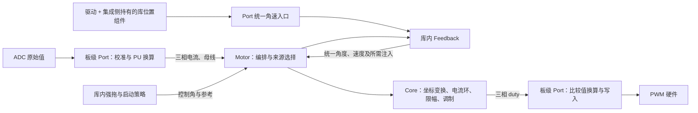
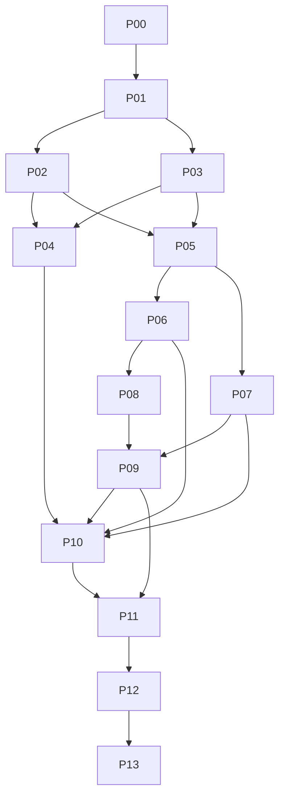

# MFOC 第一版独立库实施与发布计划

本计划的终点是交付可以脱离当前工程、移植到 Cortex-M、选择 FLOAT 或 FIXED 后端、内部使用统一标幺体系的第一版 MFOC 库。后续 FOC 功能和内部算法优化以这套骨架为基础。

**发布条件：P00—P13 全部完成，发布门禁 G1—G8 全部通过，形成可复现的发布包与验收记录。** 不能用“某块板已能转动”“文件可以编译”或“算法分别验证过”代替库级验收。本文完成只表示计划已落地，所有实施项初始均为未开始。

目标仓库为 `modus_template`；下文代码路径均相对于仓库根目录。依据为本次需求、当前工作区源码及 `mfoc/docs/framework.md`。现状文档描述已实现行为；本文描述计划目标，两者在实施完成前不能混用。保留现有工作区改动，实施中按对应工作包更新现状文档。

## 1. 第一版交付范围

| 编号 | 需求 | 发布时的判定 |
| --- | --- | --- |
| R1 | 可以独立交付 | 发布包离开本仓库仍能构建、链接和运行主机示例；核心不依赖 MODUS、perfc、MDI、厂商 HAL、RTOS 或应用对象 |
| R2 | 硬软隔离与实例隔离 | 可移植控制层只消费明确的数据与配置；硬件副作用全部位于适配层；两套实例交错执行互不污染 |
| R3 | 数据流有明确周期关系 | 固定采样/PWM 时序下，电流、前区间电压与控制角对应；时序由适配保证，不向高频入口逐拍附加通用时间戳、序号或有效性包 |
| R4 | FLOAT/FIXED 与统一 PU | 对外单位、范围、限幅、舍入和精度要求可查；局部高精度状态不泄漏为跨模块格式 |
| R5 | 保留已验证能力 | Encoder、SMO、Flux、Core、Motor、开环与无感启动经过迁移回归；HFI 完成接口及实时预算验证 |
| R6 | 能继续扩展功能 | 电流参考生成、电压合成、反馈选择、激励授权和参数应用各有唯一职责位置 |
| R7 | 四组辨识完整可用 | Rs、Ld/Lq、磁链、惯量均有公开启动入口、完成/失败/取消路径、结果读取和验证证据 |
| R8 | 发布结论有证据 | 支持矩阵、独立构建、数值回归、实机时序、第二芯片移植、接入文档和版本包一致 |

首版功能范围：电流/速度控制、已实现的反馈与启动路径、HFI、四组离线辨识、停机后的模型应用。EKF 保持 FLOAT 可选能力；若随首版对外公开，必须进入对应测试和资源矩阵，不能以“可编译”代替验证。FLOAT/FIXED 是编译期选择，不要求同一二进制同时运行两套数值 ABI。

磁链和惯量辨识首版以可靠的实际转子角度/速度为前提，使用已有编码器路径提供参考测量。辨识算法接收测量数据，不持有 Encoder 或 Feedback 对象。虚拟旋转角是激励命令，不能直接作为实际转子角。惯量结果明确为试验条件下的轴侧等效惯量，并记录联轴器、夹具和已知负载的归属。

后续版本工作：MTPA、弱磁、过调制、在线辨识、无传感器自举旋转辨识、未知任意负载下的惯量辨识、HFI 与反电势观测器全速域双向融合、FIXED EKF、单电阻采样重构、更多芯片认证。首版确定这些功能的接入位置，但不提前实现通用插件系统或所有算法。

核心支持独立多实例；首版不要求同一 MCU 的多电机同步硬件系统。基础采样范围为板级能够提供完整、有效的三相电流帧；两/单电阻的重构策略在声明支持并通过验收前不得冒充已有能力。

## 2. 当前基础与需要解决的问题

| 方面 | 可以保留的基础 | 本计划补齐的内容 |
| --- | --- | --- |
| 主框架 | Motor 编排，Core 电流环和调制，Feedback 管算法组合，叶算法拥有状态 | 保留直接调用，统一模块输入输出，硬件细节收在 Port 实现内 |
| 电压历史 | 成功提交 PWM 后才发布前拍输出 | 明确前拍模型电压与实际采样区间的固定关系；反馈与辨识共用一种契约 |
| 数值 | int32 载体的 15 位小数、BAM32、局部宽乘积、初始化预计算 | 运算范围语义、小信号积分精度、后端误差和无 FPU 覆盖 |
| Port | 直接调用、无热路径函数指针、目标负责采样和 PWM | 校准/PU 换算保留在物理边界；器件驱动、位置处理和板级准备分清，公共接口不绑定 AS5600/编码器名称 |
| HFI | 算法请求注入，Core 合成并限幅 | 运行/注入/控制角选择分开；测量八拍周期峰值及完整 ISR 预算 |
| 辨识 | Rs 流程、L 捕获/前台求值、独立磁链估计叶 | L 调度、磁链接线、惯量实现、模型事务应用、集成测试同步 |

具体依据：

- `mfoc/motor/src/mfoc_motor.c` 的 Step 同时采样、计算、提交 PWM；直接引用 perfc 进行前台计时。
- `peripheral/stm32g431/mfoc/mfoc_port.c` 同时处理 AS5600 配置、约 100 ms 校零、ADC 转 PU、母线标定、PWM 和时间；含板级单例状态。
- `mfoc/motor/include/mfoc_feedback.h` 消费完整 Core 输出；辨识主入口消费前拍请求电压；独立磁链叶又依赖 Core 输出。
- `mfoc/math/include/mfoc_numeric.h` 的 `mfoc_mul_pu` 在 FIXED 下限制输入到 ±1，FLOAT 下直接相乘；PU 并不意味着数值必须在 ±1 内。
- `mfoc/control/src/mfoc_pi.c` 的 FIXED 每拍积分增量先量化再累加，小误差可能始终无法积累；HFI 已有局部宽积分实践。
- `mfoc/identification/src/mfoc_identification.c` 的公开启动当前只接受 Rs；Ld/Lq、磁链、旋转准备仍有未接通阶段；惯量叶为占位实现。
- `mfoc/motor/src/mfoc_feedback.c` 已有“全部观测器接受参数后再提交”的模式，但未形成 Motor 层统一模型应用操作。

已有检查作为基线记录，不代表发布验收：Core、Motor 初始化、控制节拍、启停故障路径的主机 FLOAT/FIXED 回归在 HFI 关闭配置下通过；Motor 辨识测试默认配置在 `feedback_reads == 1U` 处失败，关闭 HFI 后还存在引用条件字段 `acquiring` 的编译失配。用户报告 HFI 开启后整段 step 超过 50 μs；该数值尚未在本计划中按各段和计时范围复测。

## 3. 目标架构与 Port 改造

### 3.1 选定方向

**Port 约定物理世界向 mfoc 提供的量，以及 mfoc 向硬件输出的量和动作。** 输入在边界完成标幺化，库内按统一单位计算，输出到 duty 后由板级换成 PWM 比较值。Motor 保留编排，Core 保留电流控制与调制，已经验证的算法边界不因 Port 整理而重建。

保留有类型、静态绑定的直接调用。Motor 可以调用窄 Port 接口；库的独立性要求不依赖 HAL/MDI/板级对象，主机可以提供 fake/replay Port，并不要求所有 Port 符号都从 Motor 消失。Motor_Init 继续主动调用 Port 初始化，硬件实现留在集成侧；应用无需另行调用 Port 初始化。首版不引入运行时 ops 表、通用采样消息或提交回执框架。第 3.6 节记录已实施的 Port 迁移对照；P01 的完整配置、生命周期与支持矩阵仍按工作包验收。

### 3.2 物理输入量清单

下表按物理能力整理；“可选”不表示首版必须新增该接口，更不表示每拍都要读取。由实际启用的功能决定是否接入。

| 输入量 | 控制侧约定 | 使用范围与提供者责任 |
| --- | --- | --- |
| 三相电流 `i_u/i_v/i_w` | `I/Ibase`，相序与正方向固定 | 基本电流闭环必需；板级负责 ADC 获取、零偏、增益、极性和必要的相电流重构，提供完整三相量；库内做 Clarke/Park |
| 母线电压 `v_bus` | `Vdc/Vbase` | 电压限幅、调制及模型电压所需；有采样时由板级更新，没有采样时可使用明确配置的固定值并限定适用条件，不伪称实测 |
| 实测转子角度、速度 `theta_e/omega_e` | 电角度 BAM32；电角速度按统一电角速度基值标幺化 | 有感路径按需提供；控制入口不区分编码器或霍尔，由位置源完成零位、方向、极对数、测速及必要的插值/滤波 |
| 实测定子电压 | 去共模后的三相定子电压 `V/Vbase`，线电压测量由适配转换 | 可选，用于确实需要实测电压的观测或辨识；与 duty、母线推算的模型电压分清，不要求无电压传感器的板提供 |
| 母线电流 `i_bus` | `I/Ibase`，正方向约定为电源向功率级供电 | 可选，供功率、电源侧限流等功能；不能直接代替三相电流或 `i_q` |
| 绕组、功率级温度 | 监测接口明确单位，如 °C | 可选，归低频监测/应用；需要温度补偿时才进入相应模块，不扩充高频 FOC 必需输入 |

电流和电压换算系数在准备阶段预计算，热路径只做必要换算。原始 ADC 码、传感器寄存器、计数器值不进入 Motor/Core。PU 不等于强制限制在 ±1，采样不按运行限额静默裁剪。温度等监测量不为形式统一而强行套用电流/电压基值。

**角度、速度的统一接口与硬件 Port 是两条相接的边界。** 有感位置源、SMO/Flux/HFI、强拖对象都向控制侧提供相同口径的 `theta_e/omega_e`；只有有感来源需要硬件测量。无感估计和强拖生成仍归库内对象，不放进板级 Port。统一输出不要求内部实现相同，也不要求增加函数指针。强拖的角速是命令轨迹，不能因字段相同就当成旋转辨识的实际测量。

已确定：位置算法仍归库，有感位置组件实例由集成侧持有，通过 Port 提供统一电角度/电角速度，再经 Feedback 到 Motor。现有 Encoder 的测速、滤波、角度转换等计算继续复用；器件配置/读取留在驱动。原始机械角、霍尔边沿及组件内部采样时间不提升为所有 Motor 每拍必传的字段。公共位置接口不接收父对象或具体传感器对象，不引入通用位置管理器。新增霍尔组件属于后续功能，不在本轮借接口整理扩大实现范围。

### 3.3 物理输出与辅助操作清单

| 输出或操作 | Port 边界 | 调用阶段 |
| --- | --- | --- |
| 三相占空比 `d_u/d_v/d_w` | 库输出 `[0,1]` 的 duty；板级换成定时器比较值，处理计数方式、极性和更新点 | 高频；`mfoc_port_pwm(duty)` 只写本拍输出，取消 `start` 参数 |
| 输出使能 | `mfoc_port_pwm_start(initial_duty)` 内部完成初值装载、生效和输出使能 | 启动；Motor 不展开硬件更新顺序，正常 PWM 更新没有启停含义 |
| 输出关闭 | 关闭功率输出，按板级约定保留电流采样触发 | 停止/故障；关闭与清故障分开 |
| 硬件准备、电流校零 | Motor_Init 调用 Port 初始化；板级实现准备、校准及位置提供者初始化，库算法不引用硬件实现 | 运行前；外部先准备必要时钟/触发等基础条件，无需增加独立的应用 Port 初始化步骤 |
| 有感位置前台更新 | Motor_Run 调用 `mfoc_port_position_run()`；提供者按自身周期采集，位置组件保存测速/滤波结果 | 停机和运行期间按需服务；不在高频入口等待总线 |
| 有感位置零位标定 | 根据已保持的已知电角度调用所绑定位置组件的标定操作 | 对齐前台流程；Motor 管激励和保持，位置组件管零位 |
| 物理故障读取/清除 | 硬件或驱动拥有物理故障；Motor 拥有软件运行状态。沿用明确的故障通知/停机入口，清物理故障不自动启动 | 按板能力及应用需求；不逐拍打包故障快照 |
| 单调时基及频率 | 基础 Port 契约：64 位无符号 tick，32 位 Hz；隐藏 perfc 等平台实现 | 实际需要测速、插值/外推、超时的对象使用；固定控制步长仍为配置，不给每次 Core 计算附加时间戳 |

采样率、PWM 频率、PU 基值、极对数和零位是配置；ADC 触发位置、死区、引脚与通道是硬件配置。它们不作为每拍 Port 数据重复传递。日志、波形和性能计数归应用诊断，不成为必需 Port。

### 3.4 从采样到 PWM 的职责与数据流



1. 板级配置好 ADC 触发与 PWM 更新关系；中断到来时，Port 读取已完成的采样，完成相序、零偏、比例换算，提供 PU 电流和所需母线值。
2. Motor 按已选控制模式编排。Feedback 用本拍电流和前区间模型电压估计角速；有感分支调用 Port 获取位置组件的同口径角速；强拖对象生成命令角速。Feedback 输出保持扁平的 `angle`、`speed` 字段，Motor 不新增一套 SetAngle/SetSpeedFeedback 状态。来源选择、启动交接仍在库内。辨识按实验需要消费电流、电压及实际角速，不访问器件。
3. Core 用电流、选定电角度、dq 参考和必要注入完成电流控制、合成限幅及调制，产出 duty；速度由 Motor 的速度环等消费者使用，不给不需要它的 Core 增加输入。
4. Port 把 duty 转为硬件比较值并写入。成功后按固定时序契约保留下一拍需要的输出历史；原有明确的读写失败处理继续保留，不增加通用回执或整机状态回滚。

相比当前边界，主要改善是：公共位置接口不再绑定编码器器件；硬件实现与库算法分离，Motor_Init 仍统一组织初始化；PU 基值与板级增益归属明确；库不直接引用 perfc/MDI/HAL；各对象只取得自己需要的量。直接 Port 调用、现有 Motor 编排及已验证算法可以保留。

### 3.5 固定时序与状态归属

高频路径依赖接口前提，不在每层重复做有限值、范围、新鲜度检查。采样完成及相间一致性由 ADC 触发与 Port 实现保证；控制限幅、观测器自身收敛判断及必要的故障退出仍由原对象负责。合理数值本身不能证明采样没有停更，但这不要求向 Motor 添加通用样本有效性包。

采样点、PWM 更新点与模型电压采用固定、可测的周期约定。反馈、HFI、辨识使用相同的前区间电压含义；duty 和母线推算的是模型电压，不能冒充端电压实测。适配应满足该约定；若某硬件时序带来额外延迟或区间内多次更新，应在适配配置与验证中解决，不能静默当成“上一拍”。不要求通用 pending/active 管理器、逐拍序号、时间戳或提交确认协议。

零偏/增益和硬件资源归适配绑定，位置处理状态归位置组件，观测与控制状态归各库对象，模型和运行阶段归 Motor。两套软件实例不能共享隐藏可变算法状态；首版单功率级的静态 Port 绑定不能被误称为已支持同芯片多电机硬件。

命令与 ISR 的并发、前台位置更新与 ISR 读取的一致性由集成侧和对应组件解决，不将未处理的总线事务带进高频中断。启停和硬件 Break 行为继续明确测试；故障处理不要求逐拍向所有算法传递故障结构。平台看门狗等系统机制归板级系统设计，不在本节新增为库的统一接口或强制工作包。

### 3.6 Port 接口迁移与原头文件对照

2026-11-10：本节直接函数接口已落实到 `mfoc_port.h`、Motor/Feedback、纯 Encoder 组件与 G431 适配；不增加运行时分派。具体实现与调用前提见 [Port 契约](../../mfoc/docs/port-contract.md)，基线及回归证据见 [迁移验证](../../mfoc/docs/validation/2026-11-10-port-migration.md)。这是 P01/P03/P04 中的 Port 迁移子集，不代表整项工作包或发布门禁完成。

| 当前接口 | 目标处理 | 责任与调用方 |
| --- | --- | --- |
| `mfoc_port_current(current)` | 保留 | Motor 高频采样；三相 PU |
| `mfoc_port_bus(bus)` | 保留 | Motor 按约定频率更新母线 PU |
| `mfoc_port_pwm(duty, start)` | 取消 `start`，另增 `mfoc_port_pwm_start(initial_duty)` | Step 更新，Start 启动；板级实现初值生效及使能顺序 |
| `mfoc_port_pwm_stop()` | 保留 | Stop/Trip 关闭输出 |
| `mfoc_port_init()` | 保留由 Motor_Init 调用；接收 `mfoc_port_cfg_t` | 统一提供电流/电压/电角速度基值与极对数；参数不含 Motor 或 HAL 对象 |
| `mfoc_port_encoder(angle)` | 公共控制入口改为 `mfoc_port_position(angle, speed)` | Feedback 获取电角度和电角速度；机械角读取留在具体位置源接线中 |
| `Feedback_Run → Encoder_Run` | Motor_Run 直接调用新增的 `mfoc_port_position_run()` | 集成侧更新其持有的位置实例；Feedback 不保留纯转发前台入口 |
| 无通用有感零位入口 | 增加 `mfoc_port_position_calibrate_zero(held_angle)` | 保持已知电角度期间，由 Motor 对齐流程直接调用 |
| `mfoc_port_tick()` 返回 `uint32_t` | 改为公共 `mfoc_tick_t`，定义为 `uint64_t` | 位置插值/外推及库内超时；不直接依赖 perfc |
| `mfoc_port_tick_frequency()` | 保留 `uint32_t` Hz | 初始化读取，频率与 tick 同源且运行期间稳定 |

```c
typedef uint64_t mfoc_tick_t;

mfoc_result_t mfoc_port_current(mfoc_uvw_t *current);
mfoc_result_t mfoc_port_bus(mfoc_scalar_t *bus);

mfoc_result_t mfoc_port_position(mfoc_angle_t *angle,
                                mfoc_scalar_t *speed);
mfoc_result_t mfoc_port_position_run(void);
mfoc_result_t mfoc_port_position_calibrate_zero(mfoc_angle_t held_angle);

mfoc_result_t mfoc_port_pwm(const mfoc_uvw_t *duty);
mfoc_result_t mfoc_port_pwm_start(const mfoc_uvw_t *initial_duty);
mfoc_result_t mfoc_port_pwm_stop(void);

mfoc_tick_t mfoc_port_tick(void);
uint32_t mfoc_port_tick_frequency(void);
```

`mfoc_port_position` 一次调用取得同一位置处理结果的两个量，不拆成独立读角度/读速度操作，不在 ISR 发起等待式传感器事务。返回值沿用 `mfoc_result_t`，不增加逐拍有效性数据包。公开位置入口不携带 HFI 注入或获取状态。

Feedback 保持当前扁平输出，不嵌入 `angle_speed` 成员：

```c
typedef struct {
    mfoc_angle_t angle;
    mfoc_scalar_t speed;
    mfoc_ab_t u_inject_ab;
#if MFOC_FEEDBACK_ENABLE_HFI
    bool acquiring;
#endif
} mfoc_feedback_output_t;
```

有感分支可直接调用 `mfoc_port_position(&next.angle, &next.speed)`；Motor 继续使用 `feedback.angle`、`feedback.speed`。统一角速的单位、方向和含义即可，暂不新增 `mfoc_angle_speed_t`。嵌套结构不增加函数调用深度，但会增加成员访问层级；这里不为复用两个字段引入嵌套、额外转换函数或布局强制转换。

位置算法归库、位置实例归集成侧，不等于将测速/滤波算法复制进各板 Port。具体驱动与库组件在集成侧组合；高频 Port 提供计算好的角速或执行已有的短时外推。前台采集、零位标定和初始化都通过对象操作完成，不由 Motor 读写位置对象成员。保留当前对齐结束前捕获零位、随后停止的行为；不支持该标定的来源不启用自动零位流程。

初始化保持 `应用 → Motor_Init → port_init`。已落实的统一初始化配置为：

```c
typedef struct {
    uint32_t current_base_milliamp;
    uint32_t voltage_base_millivolt;
    mfoc_scalar_t electrical_speed_base_hz;
    uint16_t pole_pairs;
} mfoc_port_cfg_t;

mfoc_result_t mfoc_port_init(const mfoc_port_cfg_t *cfg);
```

四个字段分别服务于电流换算、电压换算、速度归一化和机械角到电角转换。`electrical_speed_base_hz` 在初始化边界表示物理电频率 Hz，不是速度 PU；其类型沿用当前位置组件配置，不进入逐拍输入。Motor 从统一配置生成该初始化参数，极对数来自同一电机模型，Port 不另配一套基值。无需把整个 Motor 配置或运行对象传入 Port。

ADC 通道、分压、采样增益与 PWM 设置仍归板级；位置源的采集周期、滤波参数、方向和初始零位归相应位置配置，运行标定结果归位置实例。Port 初始化将公共配置与所绑定位置组件的专用配置组合，调用组件 Init；不把 Encoder 配置类型引入公共 Port ABI。输入配置只在初始化中读取，需要的状态/系数由相应对象保存，不借用临时配置指针。

时基宽度的源码依据：perfc 的 `get_system_ticks()` 返回 `int64_t`，MDI 的 `mdi_tick_t` 已是 `uint64_t`，当前 G431 mfoc Port 才强制截成低 32 位。采用 64 位公共计数，保留完整时间跨度；频率表示每秒 tick 数，仍用 32 位。库使用自身 typedef，不引入 perfc/MDI 公共类型。

32 位无符号差值在间隔严格小于一周回绕且相关比较约束成立时可正确计时，不能据此认定现有实现必然错误；但不将这一限制强加给整个库。移植侧负责提供前台/ISR 均可稳定读取的计数，运行期间不重置或切换时基。仅有窄硬件计数器的目标在 Port 内完成扩展，单纯强转为 64 位不构成完整时间源。

64 位类型不保证 Cortex-M 上共享读写原子性。Port 保证读时钟一致，位置组件保证发布样本一致，不依靠 `volatile` 解决跨上下文访问。公共时间戳加宽不要求所有短间隔运算都加宽：在规定范围内可保留局部 32 位差值，但不能先截断再判断过期；Encoder 原有乘法/除法的输入上界也须随迁移复核。时基读取消耗及必要临界区计入 P10，无测量证据不宣称零开销。

可选扩展仍按消费者启用：`mfoc_port_voltage(mfoc_uvw_t *)` 提供约定三相定子电压，`mfoc_port_bus_current(mfoc_scalar_t *)` 提供母线电流。温度监测、物理故障清除先留板级接口；现有故障通知可接 Motor_Trip。以上所有无实例参数接口仍按当前单功率级静态绑定理解，不代表已经实现同芯片多硬件实例绑定。

### 3.7 位置提供者的生命周期与数据接线

以集成侧持有的一个 Encoder 实例为例，前台更新与高频读取必须绑定同一个实例。Port 不再保存一份重复的角速缓存，Motor 不增加 SetFeedback 或位置样本邮箱；位置组件已有的样本发布机制就是前后台之间的数据连接。

| 阶段 | 调用关系 | 该阶段完成的工作 |
| --- | --- | --- |
| 初始化 | 应用 → Motor_Init → port_init(cfg) | 先验证并准备库内控制对象；Port 完成硬件准备、校准及位置组件初始化；全部成功后 Motor 才进入可启动状态，保持输出关闭 |
| 前台更新 | 应用 → Motor_Run → port_position_run | 提供者按自身周期获取测量，位置组件计算速度、滤波并发布样本；正常停机时也服务位置源 |
| 高频读取 | Motor_Step → Feedback_Step → port_position(angle, speed) | 从同一位置实例取得一致样本，执行必要外推与电角转换，直接填写 Feedback 本拍 angle/speed |
| 对齐标定 | Motor 对齐前台流程 → port_position_calibrate_zero(held_angle) | Motor 保持已知电角度；位置提供者取得所需测量，组件更新零位与速度历史，随后 Motor 按原流程停止 |
| 停止与再启动 | Motor_Stop / Motor_Start | Motor 管控制器和功率输出；正常停机保留位置零位，位置更新继续推进，不因重新启动重复执行硬件初始化 |

Motor_Init 完成对象与硬件准备，不自动开启 PWM。沿用当前先通过前台 Run 建立位置测量再进入有感闭环的用法；没有测量时不凭空发布零角度作为成功结果。不同位置源建立初始角速的具体方式仍由对应组件负责，不增加公共样本就绪数据包。

```text
前台：
Motor_Run → port_position_run → 驱动采集 → 同一位置组件更新/发布
                                                   │
                                      组件自身样本与发布索引
                                                   │
高频：                                             ↓
Motor_Step → Feedback_Step → port_position → 位置组件读取/外推
                                │
                  直接写 next.angle、next.speed
                                ↓
                   Feedback 本拍输出 → Motor → Core
```

以现有 Encoder 为例，Run 发布的是机械角、速度和内部采样时间，Step 获取一致样本并外推电角度；速度 PU 可以复用前台已算结果。位置采样 1 kHz、FOC 20 kHz 时，两次采样间仍可逐拍外推控制角，无需将前台电角度原样保持 20 拍。这只是时序示例，不规定所有传感器的采样率。

有感分支的接入就是 `rc = mfoc_port_position(&next.angle, &next.speed)`。`next` 是 Feedback 的本拍局部输出，不是新增长期状态；后续按当前后端选择和返回处理交给 Motor。有感输入与 SMO/Flux/HFI 输出同口径，Feedback 不反向拥有或修改板级位置实例。强拖轨迹继续由库内启动路径产生。

前台写入组件未发布的样本槽，完整写入后切换发布索引；ISR 读取一份已发布样本。沿用当前单核、单前台写者、高优先级非重入 ISR 读者的并发约定。64 位 tick 同样纳入该完整样本，不单独修改已发布字段；若新平台改变写者或优先级关系，需在该组件/适配内落实一致性，不能只沿用 volatile 声明。

`port_position_run` 调用频率不强制等于采样频率，采集间隔归提供者。霍尔等事件采集由驱动中断保存测量，前台入口只推进实际需要的工作；无前台工作时无需制造一次计算。未启用有感能力的构建裁掉位置服务及读取调用，不要求无感路径实现假位置数据。

源码走查发现当前 Motor_Run 的辨识分支先于 Feedback_Run 且会提前返回。迁移时，有感位置前台服务应在可能跳过它的模式分支之前得到调用；后续需要实际角速的磁链/惯量辨识不能因此停止位置更新。采集错误也不能让 Motor 提前跳过应执行的对齐超时、停止或故障收尾。组件继续负责自身测量失败/超时行为，是否退出控制由当前消费者决定，不额外新增多层检查。

零位标定由 Motor 在固定角保持期间直接调用 Port，位置组件通过自身操作完成变更，遵守现有避免 ISR 并发读取被修改状态的条件。取消对齐不提交零位，标定读取失败不覆盖原零位。位置业务移出 Feedback 后，当前只转发 Encoder 操作的 Feedback_Run/CalibrateZero 无其他职责时移除，不保留空包装层。

实例迁移不能只改调用名字：当前 Encoder_Run/CalibrateZero 内还直接读取旧的机械角 Port，实施时须按新的驱动/位置组件接线调整原始测量入口。复用测速、滤波、外推与样本发布算法，不让统一的电角度 Port 回调自身造成递归或被当作原始机械角。高频 Port 的静态绑定按实际编译调用链检查开销和深度，不将“薄包装”当作已经零成本的证据。

## 4. 总计划表

所有项均为首版发布必做项。“完成”须同时有实现、测试和记录。各项验收记录随实施更新。

| 编号 | 工作包与主要交付物 | 前置 | 完成判据 | 状态 |
| --- | --- | --- | --- | --- |
| P00 | 冻结现状基线、目标板与验收范围；形成 baseline 文档 | 无 | 已验证/未实现能力分清，数值与实机测量准则预先写定 | 未开始 |
| P01 | 定义公共数据、单位、时序、生命周期与 Port 契约 | P00 | 本文第 3 节落为接口规范和支持矩阵，无硬件动作归属空白 | 未开始 |
| P02 | Motor/位置组件解除平台依赖，统一角速与生命周期边界 | P01 | 可接主机 Port 独立运行；两实例隔离；原有失败处理保持 | 完成（[2026-11-12 验收](#p02-verification)） |
| P03 | 采样标定、PU 换算与物理量输入边界 | P01 | 标定不占用高频计算；状态归属明确；FLOAT/FIXED 口径一致 | 未开始 |
| P04 | G431 参考适配迁移，落实采样与 PWM 固定时序 | P02、P03 | 原板功能保持，硬件初始化/关断/输出时序符合契约 | 未开始 |
| P05 | 统一前区间电压和 Core 合成/限幅边界 | P02、P03 | Feedback/辨识共用输入语义，限幅与回授无分叉 | 未开始 |
| P06 | 数值后端契约、局部精度与固定点覆盖 | P05 | 范围、舍入、积分小信号及边界误差通过回归 | 未开始 |
| P07 | 参考生成、反馈选择与激励控制权收口 | P02、P05 | 每拍唯一最终命令；HFI 运行/注入/选择独立可解释 | 未开始 |
| P08 | Motor 层停机模型事务应用 | P02、P06 | 成功统一生效；失败整组保持旧模型和系数 | 未开始 |
| P09 | 四组离线辨识接通与验证 | P03、P05、P07、P08 | Rs/Ld/Lq/磁链/惯量完整公开流程和验证，取消/失败可靠 | 未开始 |
| P10 | HFI 与完整实时链性能优化 | P04、P06、P07、P09 | 生产配置全部关键路径满足实际 PWM 截止预算 | 未开始 |
| P11 | 独立构建、配置组合和系统回归 | P02—P10 | 独立目录可链接运行；全部发布组合通过；无隐藏外部依赖 | 未开始 |
| P12 | 第二芯片迁移与最终实机验收 | P04、P11 | 换芯片只改适配/配置；发布矩阵中的板上能力均有证据 | 未开始 |
| P13 | 发布包、文档、版本及交付核验 | P12 | G1—G8 全通过；干净环境消费发布包可复现 | 未开始 |

依赖允许 P02/P03 并行，也允许 P06/P07 在 P05 后分开推进；接线和实机回归按共同接口版本收敛。



## 5. 工作包实施与验收说明

路径标注“新增”表示拟创建的位置；实施时可以调整文件组织，但必须保持职责、测试及证据映射。接口迁移先保留算法递推和采样顺序，性能或数值行为调整单独验证。

### P00 基线与发布范围

- [ ] 交付基线、验收指标和第一版支持矩阵。对应 R5、R8。

读取现有 `mfoc/tests/`、G431 应用配置和板级绑定，保存可回放输入及配置；辨识旧测试先标记失配原因，不能机械修改断言来制造绿灯。确定第二款不同于 G431 的 Cortex-M 板，优先核对现有 AT32 目标及硬件条件；其 FIXED 运行验证不能用假 Port 替代。

新增 `mfoc/docs/validation-baseline.md`、`mfoc/docs/support-matrix.md`、`mfoc/tests/fixtures/` 的必要基线数据。测量前冻结各算法误差/稳态/收敛、正反转与负载工况、四项辨识误差与重复性门限，并记录参考测量的不确定度。每项实验还须定义允许电流、转速、激励幅值、持续时间及越限退出期限。无可靠参考值不能声称辨识精度通过。发布指标不得在看到结果后无记录地放宽。

验收：基线可重复播放；每个后续行为变更能指出比较对象和容限；第二板型号、采样/PWM时序、可用工具和试验条件已记录。P00 完成不代表第二板已适配。

### P01 公共契约

- [ ] 将第 3 节落为接口规范。对应 R2、R3、R4、R6。

涉及 `mfoc/port/include/mfoc_port.h`、`mfoc/motor/include/mfoc_motor.h`、`mfoc/motor/include/mfoc_feedback.h`、`mfoc/core/include/mfoc_core.h` 及辨识头；新增 `mfoc/docs/port-contract.md`。配置按库裁剪、PU 基值/模型、控制参数、板级电气参数、硬件时序分类。修改电机 profile 不需要编辑库源码；同一构建中不同实例可以有独立模型和基值，换算系数在 Init 生成。

按第 3.2/3.3/3.6/3.7 节冻结必需接口及实际使用的可选接口，列出单位、范围、坐标、正方向、写者/读者和初始化要求。有感、无感、强拖的控制侧输出统一为电角度/电角速度，保持 Feedback 扁平字段；保留实际测量与命令轨迹的用途区别。明确采样和 PWM 更新的固定关系，不增加每拍有效性、时间或故障包。Init 继续由 Motor 发起，公共配置提供三项基值和极对数；位置实例由集成侧持有，Motor_Run 主动推进其前台服务；PWM 更新与启动分开。确认完整生命周期表与源码迁移清单一致。

公共时基采用 64 位无符号 tick 与 32 位频率，约定稳定读取及运行期间不重置，局部间隔计算有明确范围。位置组件自行处理测量延迟及外推，不能把总线完成时刻无条件视为真实测量时刻。验收走查正常运行、首次无历史、已有读写失败、Break、启动取消和重启，确保各有所有者；同步项目规范的库/应用适用范围。纯文档阶段无需新增行为测试，情景在 P02—P05 兑现。

### P02 可移植 Motor 与生命周期

- [x] 移除库内平台依赖，统一控制侧角速，保留 Motor 主动调用 Port 的生命周期编排。对应 R1、R2、R3、R5。

修改 `mfoc/motor/src/mfoc_motor.c`、`mfoc/position/src/mfoc_encoder.c` 及对应头、`mfoc/motor/src/mfoc_sensorless_start.c`、辨识调度源文件与公开头；移除公共库中的 perfc 类型和直接平台调用，以公共 tick/frequency 完成所需计时。Motor 保留调用窄 Port 的编排，Core/反馈/辨识继续消费明确的数据。有感位置实例移到集成侧，Feedback 通过 Port 获取角速，保留扁平输出；位置组件不配置具体传感器。统一角速口径，不为了统一字段改写已验证的估计与启动递推。

子模块状态迁移通过其语义操作完成，不让适配层直接改 PI、启动或观测器成员。Motor_Init 调用 Port 初始化，Motor_Run 直接推进位置前台服务，Motor_Start/Step/Stop 分别使用启动、更新、关闭接口；对齐流程直接经有感零位 Port 操作接到位置组件。移除已无业务的 Feedback 前台/标定转发，避免额外调用层。准备、校准和物理使能的具体实现仍在集成侧。扩展 `mfoc/tests/motor/motor_test.c`、`motor_run_test.c`、`motor_control_test.c`、`mfoc/tests/position/encoder_test.c`，使用有类型的 fake/replay Port 在无硬件条件下测试完整生命周期。

测试：Motor_Init 正确传入基值/极对数并传播 Port 失败；两个不同配置软件实例在对应测试绑定下交错 Step 与 Stop；角速方向/零位/单位一致；前台更新与高频读取绑定同一实例；停机及需要实际位置的辨识期间仍更新；采集失败不跳过对齐超时或停止收尾；对齐标定成功/失败/取消；PWM 更新不使能输出；PWM 拒绝后不发布正常输出历史；清故障不自启；首次样本和重启；位置组件前台发布与 ISR 一致读取。时间覆盖跨低 32 位回绕、长时间停顿后的现有超时行为和有界间隔换算，不能只改返回类型而保留截断状态。验收为链接仅需声明的标准库及 Port 实现，无 HAL/MDI/perfc/应用对象，已有功能基线未被接口迁移改变。

<a id="p02-verification"></a>

**2026-11-12 验收记录**（基于 `4a8514e` 的 P02 改动）。原版本在仓库外编译辨识头时缺少 `perf_counter.h`。MFOC 在公共头 `mfoc_types.h` 定义进度返回类型 `mfoc_fsm_rt_t`。辨识模块管理自己的阶段推进，库构建清单已移除 MODUS 路径。主机消费者只用导出目录内的生产源码、自己的 Port 和标准库。

辨识前台通过实例内的 `run_pt` 保存等待位置。独立构建使用 C11 PT，G431 通过 `MFOC_USE_PERFC_FSM=1` 使用原生 perfc PT。运行 `.\mfoc\tests\scripts\run_core_tests.ps1 -Tests motor_identification` 可回放 Rs、超时和取消重启；追加 `-Perfc` 可用 perfc 执行同一组断言。

| 仓库外配置 | 运行结果 |
| --- | --- |
| FLOAT、FIXED，辨识关闭 | 两个配置不同的 Motor 交错运行。先停 A，B 继续执行，其三相 duty 与单独回放 B 的结果逐分量相同 |
| FLOAT、FIXED，辨识开启 | 同一双实例用例通过。另以已知 1.2 PU 电阻模型驱动真实 Motor 与 Rs 流程，两种配置均测得 1.2000 PU，实验完成后 PWM 关闭 |

复跑使用 [独立构建脚本](../../mfoc/tests/scripts/run_standalone_tests.ps1) 和 [主机回归](../../mfoc/tests/scripts/run_tests.ps1)。回归覆盖延迟首次轮询、完成事件与超时同拍、下一阶段独立计时、取消后重启和故障关断。Cortex-M0 FIXED、Cortex-M4 FLOAT 通过开启辨识的库对象编译，G431 FIXED 开启辨识的固件完成链接。Rs 数值来自主机电阻模型，台架辨识精度和 PWM/ADC 实际时序按后续工作包验收。

### P03 采样标定与数据准备

- [ ] 约定校准、PU 换算及物理量准备的所有者。对应 R2、R3、R4。

整理 `peripheral/stm32g431/mfoc/mfoc_port.c` 及配置：硬件驱动获取原始值，Port 完成零偏、相序、极性与 PU 换算后提供控制量。板级绑定持有零偏、预计算增益和准备状态。重复的纯换算数学可以复用，但不预设新增 `sampling` 对象、目录或逐拍数据包装层。

物理量和 PU 换算只在边界发生，ADC 量程不等于运行电流限值，测量不被静默裁成 ±1 PU。校准在 Motor_Init 调用的 Port 准备过程中完成，明确采样数、终止和失败行为，不占用高频计算；需要异步准备的目标另行明确完成契约，不能未准备好却返回初始化成功。母线刷新率及有感位置处理由各自提供者落实，不要求所有量每拍重采或随数据附带时间。

扩展现有 Port 测试，覆盖正负电流、极性/相序、ADC 边界、过零、零偏与校准失败、不同 PU 基值、母线换算和 FLOAT/FIXED 一致性。成功校准后再启用控制，不能让 ISR 读取半更新的系数。主机 replay Port 直接提供约定 PU 数据，绕开硬件采集。

### P04 G431 参考适配

- [ ] 当前应用迁移到新契约并保住实机基线。对应 R2、R3、R5。

修改 `peripheral/stm32g431/mfoc/mfoc_port.c`、`target/stm32g431/mfoc_motor_irq.c`、`target/stm32g431/mfoc_motor_irq_binding.h`、`class/mfoc_app.c`。库外保留目标驱动与直接调用；Port 初始化组合公共换算配置与专用位置配置，调用驱动完成 AS5600 配置并初始化位置组件。位置实例由集成侧持有，port_position_run 与 port_position 绑定该同一实例，分别完成前台更新及高频结果输出；IRQ/波形仍归目标集成。原机械角诊断转接相应驱动/位置源诊断，不把新电角度接口当作机械角接口使用。沿用经整理的 Motor Init/Run/Step 编排，应用不额外调用一套位置调度，不复制控制算法。

修改 `mfoc/tests/port/port_test.c`、`mfoc/tests/motor/motor_irq_test.c`；新增 `mfoc/tests/port/port_contract_test.c`。

测试：启动接口使中性 duty 生效后才开门极，普通 PWM 接口只更新输出；ADC 数据与触发对应；duty 到比较值的换算、量化及更新方式；现有读写失败与关断行为；Break；停止保留采样触发；前台 I2C 不进入 ISR；64 位时钟在前台/ISR 的一致读取。板上核对 ADC 触发、计算和比较值生效点，不用单元测试代替时序测量，也不为验证加入生产路径逐拍校验层。

### P05 统一前区间模型与 Core 合成

- [ ] 反馈、HFI、辨识共用相同前区间电压语义。对应 R3、R5、R6。

修改 `mfoc/control/src/mfoc_modulation.c`、`mfoc/core/src/mfoc_core.c`、Feedback 与辨识输入。Motor 保留必要前拍输出，使用库内纯数学形成统一模型电压，Feedback/HFI/辨识不各自解释一套历史。模型与实际采样区间的对应由固定 Port 时序保证；若硬件有额外延迟，须明确适配方式并验证，不给所有控制对象增加通用时间字段。模型可包含已实现补偿，不能把命令值标为实测值；直接电压辨识遵守相同周期关系。

Core 保留 PI、注入及将来 dq 前馈的明确合成位置，合成后统一限幅和抗饱和。首版不实现尚未需要的前馈算法；保留电压 `V/Vbase` 与调制 `V/Vdc` 的区别。

扩展 `mfoc/tests/core/core_test.c`、Feedback 算法集成测试；新增 `mfoc/tests/motor/voltage_interval_test.c`。测试首次无历史、母线变化、限幅、PWM 失败后停止与重启、直接电压辨识，以及已声明支持的采样/更新关系。量化误差有容限；硬件不得静默进行契约外的脉宽修正。相同区间的消费者收到同口径电压，HFI 激励与对应电流增量经板上验证。

### P06 数值契约与精度

- [ ] 完成数值范围说明、局部精度修复与两后端回归。对应 R4、R5。

修改 `mfoc/math/include/mfoc_numeric.h`、`mfoc/math/src/mfoc_numeric.c`、`mfoc/control/src/mfoc_pi.c` 及必要的算法配置；新增 `mfoc/docs/numeric-contract.md`。保留公共 int32/15 位小数和 BAM32 的基础，限定范围乘法必须有显式语义，普通 PU 运算不默认为 ±1。按证据为 PI 等必要积分状态保留余量；不机械统一所有算法内部 Q 格式。

将 `mfoc/position/include/mfoc_hfi.h`、`mfoc/identification/include/mfoc_identification_algorithms.h`、启动与各观测器中依赖全局基值/采样频率的系数，统一由所属实例的 Init 配置生成。功能裁剪、表长和工作区最大容量仍可在编译期决定；频率不同引起的离散行为必须在支持范围内单独验收。

扩展 `mfoc/tests/math/math_test.c`、`mfoc/tests/control/pi_test.c`；新增 `mfoc/tests/control/pi_precision_test.c`。测试包括超过 1 PU 的合法输入、正负舍入、载体极值、向零截断、小误差持续积分、限幅及恢复、复位、模型参数可表示范围、后端边界一致性。纯接口整理的 FIXED 逐拍结果保持一致；精度改善单列行为差异及容限，不能混入等价重构报告。

明确 FIXED 热路径禁用运行时软浮点；常量表达式、边界配置及 Init 可有经审查的浮点转换，并记录是否带来库依赖。EKF 的 FLOAT-only 编译拒绝属于支持矩阵，不强行定点化。数字接口与 CMSIS 等目标加速接口的格式转换须有误差证明。

### P07 参考生成与控制权

- [ ] 每拍确定唯一角度来源、最终电流参考和注入许可。对应 R5、R6。

修改 `mfoc/motor/src/mfoc_motor.c` 的参考选择、`mfoc/motor/src/mfoc_feedback.c`、`mfoc/motor/src/mfoc_sensorless_start.c`。明确普通控制、对齐、强拖、无感交接、HFI 获取和辨识的优先关系。辨识输出表达需要的控制方式，不要求 Motor 解码其内部阶段编码来推断如何执行。

速度 PI 输出与最终 dq 参考组合有独立步骤；避免今后速度环更新无条件覆盖其他参考来源。HFI 的编译使能、计算运行、主动注入和选作控制角分清。无效观察结果与允许接管分开；保留现有捕获、稳定窗口和混合策略。

扩展 `mfoc/tests/motor/motor_control_test.c`、`motor_handover_test.c`、`hfi_motor_test.c`、`mfoc/tests/position/hfi_channel_test.c`。测试冲突请求被拒绝或明确仲裁、HFI 计算但不获注入许可、获取时暂停基波/速度调节、捕获前后反馈失效、取消启动和重新启动。MTPA/弱磁等只在文档标注后续接入点。

### P08 停机模型事务

- [ ] 通过 Motor 统一应用辨识或配置得到的模型。对应 R2、R4、R7。

修改 `mfoc/motor/include/mfoc_motor.h`、`mfoc/motor/src/mfoc_motor.c` 和 `mfoc/motor/src/mfoc_feedback.c`；新增 `mfoc/tests/motor/motor_model_update_test.c`。沿用现有 Feedback 的先验证/准备、后提交模式，把 Motor 模型和所有相关预计算系数纳入同一事务。

只允许在停止且无并发计算时应用，默认保持 PU 基值和极对数；更改基值/极对数需要完整重新初始化。辨识结果必须携带或绑定可核对的基值描述，应用入口拒绝不匹配的 PU 结果；跨基值复用须在边界显式转换后再验证，不在热路径隐式换算。明确哪些控制增益保持、哪些必须重整定；不把更新 Rs/L 解释为 PI 已自动整定。辨识结果只产出，不自动生效。

测试成功整体更新、某个观测器拒绝后的整体保持、运行中更新被拒绝、再次启动、重复应用、跨实例错误基值结果被拒绝，以及不同实例互不影响。任何失败都不得留下新模型配旧系数或旧模型配新系数。

### P09 四组离线辨识

- [ ] P09a：Rs 完整流程与统一 PU 输入及前区间电压接线。
- [ ] P09b：Ld/Lq 的轴准备、脉冲调度、捕获和 Finish 接通。
- [ ] P09c：磁链旋转准备、实际角速输入、稳态判定和退出接通。
- [ ] P09d：惯量算法与有明确负载前提的完整实验实现。
- [ ] P09e：统一结果、取消/超时/故障语义及板上对照。以上全部对应 R7。

修改 `mfoc/identification/include/`、`mfoc/identification/src/` 及 Motor 辨识路由。保留 Rs/L 的 ISR 低成本捕获、前台冻结数据求值；旋转辨识所需实际角速由 Motor 通过有感位置 Port 获取后填入类型化输入，位置前台服务不得被辨识分支跳过。叶算法不接收 Core/Feedback 对象，不将经过强拖选择的控制角当作转子测量。不同实验保留各自必要输入，不强求相同 Step 签名。

实验依赖明确：Ld/Lq 使用已知或有效辨识的 Rs；磁链使用有效 Rs/L 与实际角速；惯量使用有效转矩模型及明确试验负载。缺少所需条件时拒绝启动。辨识限制激励幅值与持续时间，Motor 对真实采样的电流/速度执行运行限额检查并发出停止；Port 执行关断，板级硬件保护保持原有职责。直接电压实验也必须经过这条限额路径，不能因绕开电流 PI 而绕开限制。

扩展 `mfoc/tests/identification/identification_rs_test.c`、`identification_inductance_test.c`、`mfoc/tests/motor/motor_identification_test.c`；新增 `mfoc/tests/identification/identification_flux_test.c`、`identification_inertia_test.c`。

测试公开启动到完成、解析电气/机械模型、采样与激励错位、实际角速失效、非稳态拒绝、直接电压/虚拟控制两通路的电流和转速越限退出、激励幅值/持续时间上限、取消/超时、失败不覆盖有效结果、异常结果不发布/不应用、完成后停机、读结果与 P08 应用。修复旧集成测试与新路由失配，并覆盖 HFI 开/关的结构裁剪。每项以 P00 冻结的参考方法和误差/重复性门限形成板上记录；未完成的占位接口不能进入已支持清单。

### P10 实时预算与 HFI 优化

- [ ] 用目标测量定位热点并满足完整实时链预算。对应 R5、R8。

涉及 `mfoc/position/src/mfoc_hfi.c`、`mfoc/math/src/mfoc_angle.c`、`mfoc/math/include/mfoc_trig.h`、目标 IRQ 与诊断。先分解采样/换算、各启用反馈、Core、提交、诊断开销，记录 HFI 普通拍与每八拍重计算拍、获取/跟踪/极性分支以及限幅/故障路径；四组辨识的 ISR 激励、捕获、阶段切换和失败路径同样纳入。热点定位可与 P09 并行，P10 最终验收必须基于辨识已全部集成的版本。FLOAT+LUT 并不自动替换 atan2；目标外部数学后端沿用直接绑定，优化位置由测量决定。

扩展 HFI 算法与通道测试；新增 `mfoc/tests/scripts/check_realtime_symbols.ps1` 和 `mfoc/docs/performance.md`。任何近似、除法替换、分步运算必须比较角度/速度误差、锁定与失效行为，防止以改变时序语义换取平均速度。

验收采用实际“采样完成至 PWM 最晚写入”的可用窗口，计划保留至少 20% 余量。响应时间包括 IRQ 入口延迟、允许的屏蔽/抢占、计算和比较值写入；不能只量 Step 函数。若窗口确为 50 μs，则完整响应目标不超过 40 μs；若有效窗口更短，按更短窗口计算。冻结允许的中断负载，记录最坏分支分析与测得最大值，测量最大值不能单独当成严格 WCET 证明。生产配置关闭诊断后验收，诊断增量单列；HFI 发布配置不能通过关闭 HFI 来过关。

### P11 独立构建与系统回归

- [ ] 所有发布组合在独立消费环境中通过。对应 R1、R2、R4、R5、R8。

修改 `mfoc/mfoc.mk`、测试脚本与 `mfoc/mfoc.h` 的公共入口；新增最小 `mfoc/examples/host_replay/`、芯片无关示例配置和 `mfoc/tests/scripts/check_standalone.ps1`。整理可选算法源码与配置，使用 C11 基础及必要的明示编译器扩展；库无堆分配要求，静态表允许存在，各编译单元必须共享一致裁剪配置。

导出一个只含库、公共配置、示例和必要许可证信息的临时目录；主机示例提供 fake/replay Port，实现声明的物理量与输出接口。在无 `../modus`、无厂商目录、无原工程应用对象的环境编译、完整链接并运行，不能以原仓库 include 路径兜底。允许使用有明确清单的标准 C 内存/数学函数及编译器运行库，独立链接示例须提供对应设置。原工程 Make 集成与独立消费共用同一源码。是否增加 CMake 不作为发布必要条件，提供可靠源码清单和可运行构建示例即可。

扩展 `mfoc/tests/scripts/run_tests.ps1`、`check_arm.ps1`；主入口必须执行全部公布算法的测试，包含现有独立 Flux/EKF 脚本及启动交接回归。测试矩阵包括主机 FLOAT/FIXED、Cortex-M0 FIXED 完整链接、Cortex-M4F FLOAT/FIXED、EKF FIXED 拒绝、各公布 backend、HFI/辨识开关。检查软浮点热路径、未定义符号、隐藏全局、资源用量及两实例差异配置回放。

新增 `mfoc/tests/motor/per_unit_invariance_test.c`：对同一物理电机、激励与采样轨迹，使用两套合法 PU 基值运行采样、控制、观测和四组辨识，换回物理量后满足预设容限；验证各实例频率系数独立生成。分别测试基值缩放等价性和不同采样率下的模型误差，不能要求不同采样率逐拍完全一致。M0 编译/链接通过不等于该芯片已达到 20 kHz。

### P12 第二芯片与最终板上验收

- [ ] 在第二款芯片实施新适配，并完成最终发布配置的实机矩阵。对应 R2、R3、R5、R7、R8。

在 P00 选定的 `peripheral/<chip>/mfoc/` 与 `target/<chip>/` 实现板级接线和配置；路径占位在 P00 换成实际目标。新增该目标的 Port 契约测试及 `mfoc/docs/validation/` 下记录。只为适配需要修改算法文件意味着边界未通过，应回到对应工作包解决，不把芯片判断加入算法。

第二芯片至少验证 FIXED 基础闭环、启停/故障、采样/PWM 区间以及一种有效反馈路径；每款板明确公布可运行功能与频率。G431 参考板完成首版全部必做功能，包括 HFI 与四组辨识。算法级 FLOAT/FIXED 回归覆盖四组辨识；发布矩阵中额外声称实机支持的组合必须补对应板上记录。

验收包含实际控制周期、资源、温升/负载试验条件、方向/极性、启动重复性、观测器交接、异常关断和长时间运行；量化目标使用 P00 预先冻结值。保留 MCU/板型、时钟、工具链、优化选项、库版本、配置、波形/计时和参考测量。第二板未完成时 G6 保持未通过。

### P13 发布交付

- [ ] 生成并复核版本包和全部接入资料。对应 R1—R8。

更新 `mfoc/README.md`、`mfoc/docs/framework.md`、Port/数值/支持矩阵文档；新增 `mfoc/docs/getting-started.md`、`mfoc/docs/extension-guide.md`、`mfoc/CHANGELOG.md`、`mfoc/docs/release-v1-checklist.md`。给出初始化、校准、周期接线、命令提交、停机、错误处理、参数应用和增加算法的最小示例，记录旧 API 的迁移方式。

明确版本标识、源码分发布局、公共 API 稳定范围、编译配置一致性、许可证与第三方来源。许可证选择和对外发布渠道由项目所有者在本工作包确定，不能由工具擅自选定；这是对外交付信息，不能缺失后仍称发布完成。无需为首版重建仓库或设计动态二进制插件 ABI。

从待发布包重新执行 P11 的独立消费验证，核对文档、头文件、支持矩阵及实测版本一致。发布候选准备完成后再执行实际版本标记与分发；本文不代表这些动作已经执行。

## 6. 发布门禁

| 门禁 | 必须提供的证据 | 阻止发布的情况 |
| --- | --- | --- |
| G1 独立性 | 导出包独立编译、链接、运行；依赖与符号检查记录 | 仍需相邻 MODUS/perfc/应用对象，或只完成逐文件编译 |
| G2 隔离性 | 两实例不同配置交错运行；状态与调用者所有权审计 | 核心隐藏可变全局、实例串扰、通过直接改子对象成员完成生命周期 |
| G3 Port 与周期契约 | PU/duty 换算测试；采样/前区间电压/PWM 更新对应图与板上测量 | 单位/相序不一致、前拍模型与实际区间错位、输出失败仍继续正常控制 |
| G4 数值 | 后端支持表、范围/舍入文档、小信号与饱和回归、误差证据 | 只保证 FLOAT 正常；FIXED 静默改变单位/范围；未知热路径软浮点 |
| G5 功能 | 已验证功能迁移回归与四组辨识完整证据 | 以 TODO/占位/不可启动流程宣称支持；丢失原有启动或保护行为 |
| G6 移植 | G431 与第二芯片接入记录、平台功能/频率表 | 换芯片需修改算法；第二板只有 fake 或编译记录 |
| G7 实时性 | 实际截止窗口、最坏分支与最大耗时、资源余量 | HFI 周期峰值越界；只报均值或只报算法局部耗时 |
| G8 可交付性 | 文档、示例、许可证、版本、变更记录、发布包复现 | 文档支持范围超过证据，或消费者无法按步骤接入 |

状态只允许“未开始 / 进行中 / 待验收 / 完成”。每个工作包完成时填写实现版本、验证配置、测试/实机证据与剩余限制。发布必做项不存在默认豁免；若后续调整范围，应修改范围和支持矩阵并重新审查，不能把未通过项直接勾选完成。

## 7. 执行顺序与变更控制

第一阶段完成 P00/P01，先冻结物理量、PU 口径、Port 操作和固定周期关系；第二阶段完成 P02—P05，把同一已验证算法迁到新骨架并恢复 G431 基线；第三阶段完成 P06—P10，解决数值、控制权、参数应用、辨识和性能；第四阶段完成 P11—P13，验证独立交付、第二芯片和最终发布包。

每次改动以一个可验证边界为单位。接口整理保持算法递推顺序，数值精度改善和算法性能优化分别记录行为差异。测试失败先判断契约失配还是实现错误，不删除有效验证来适配实现。只有相关实现或配置变化才重跑受影响的板上试验，最终发布候选完成完整门禁复核。

实施前必须确定的事项已归入 P00/P01：第二板型号、实际 PWM 截止窗口、性能生产配置、算法和辨识验收阈值、Port 必需/可选物理量及其单位和周期关系。实现中才能得出的事项包括热点归因、具体数学优化和最终 RAM/栈占用，由 P06/P10/P11 产生证据。它们是有交付节点的任务，不是可以带进发布包的未定项。

所有实机动作按项目调试规范执行，台架上电、烧录及运行验证与主机测试区分记录。本轮只维护发布计划，不更改控制代码、现有工作区配置或已验证电机行为。


## 2026-11-10 Port 实施记录

- 已实施：显式共同基值，Motor_Init 继续调用 Port；PWM 更新/启动/停止拆开；统一电角度/速度接口；板级持有 Encoder；Motor_Run 先服务位置再推进辨识/对齐；64 位 tick，Motor/辨识的超时改用 Port 时钟；Feedback 保持平铺输出。
- 保持原算法：Core、PI、SMO、Flux、HFI、SensorlessStart 和辨识叶子未改递推。Encoder 保留滤波、速度换算、外推，只拆出硬件采集和采样节拍，并防止长于 32 位周期的停顿被截短。HFI 仍使用编译期速度基值，Motor_Init 在启用 HFI 时拒绝不一致配置。
- G431 构建的数值后端由顶层 MFOC_NUMERIC 唯一选择；具体测试、既有失败及构建结果以验证文档为准。
- 后续仍需完成：辨识 PT 公共类型的平台依赖移除、独立库打包、未实现辨识调度、第二芯片和台架性能/时序验收。当前单功率级静态绑定，不宣称支持同时绑定多个硬件电机。
