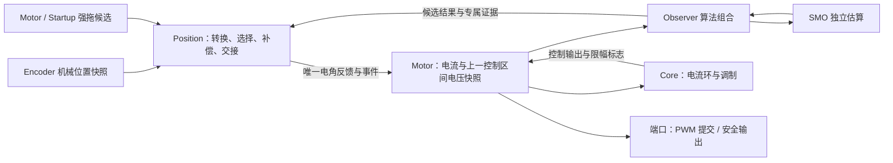
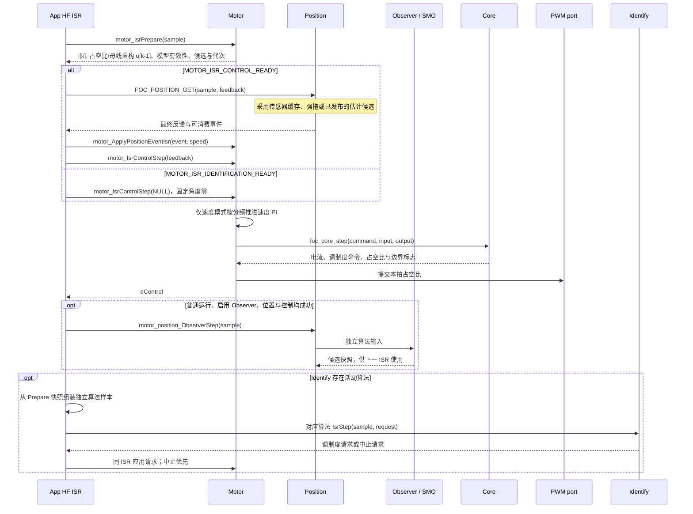

# FOC 当前架构与模块边界

更新：2026-10-09。本文对照当前工作区源码，描述已实现的对象、数据契约和执行顺序。设计约束详见 [模块架构参考第 7 节](../../.agents/skills/foc-motor-control-methodology/references/foc-module-architecture.md)，数值约定详见 [标幺与离散时间参考第 8 节](../../.agents/skills/foc-motor-control-methodology/references/per-unit-fixed-point-and-discrete-time.md)。日期归档记录当次变化，本文件随实现更新。

## 1. 对象所有权与职责

`foc_app_t` 是 MODUS 组合入口，按值拥有 Motor、Position、Encoder 和 Identify。Position 拥有 Observer；Observer 按值拥有启用算法的状态；Motor 拥有 Core、速度 PI 和 Startup 轨迹。可变状态属于各自实例，纯数据输入输出允许按值或 const 指针传递。

| 模块 / 源码 | 拥有的状态和职责 | 对外边界 |
|---|---|---|
| [App](../app/foc_app.c) | 配置绑定、前台调度、ISR 编排、辨识样本组装和请求应用 | 连接模块的类型明确接口 |
| [Motor](../motor/motor.c) | 生命周期、ADC 零偏/归一化、Clarke、速度环、Core、PWM 提交、ALIGN、安全输出 | 接收最终电角反馈，提供采样快照和控制结果 |
| [Startup](../motor/motor_startup.h) | Motor 拥有的强制电角轨迹、速度斜坡和步进历史 | 产生强拖候选；不判断观测器接管 |
| [Position](../motor/motor_position.h) | 机械角转电角、零位补偿、速度换算、候选快照、SMO 资格及交接进度 | 发布唯一电角反馈和接管/丢失事件 |
| [Encoder](../observer/foc_encoder.h) | 前台读取机械位置、机械速度滤波、带时间戳的缓存发布 | ISR 读取机械位置快照，不在 ISR 进行传感器总线读取 |
| [Observer](../observer/foc_observer.h) | 编译期算法集合的初始化、推进与复位 | 独立算法输入和候选结果；选择由 Position 完成 |
| [SMO](../observer/foc_smo.h) | PU 离散系数、估计电流、滑模/反电势历史、角差速度 | 自己的 input/cfg/state/output 类型，无父对象依赖 |
| [Core](../middleware/foc_core.h) | 电流 PI、Park/逆 Park、SVPWM 及限幅标志计算 | 数学输入输出；PWM 硬件提交归 Motor |
| [Identify](../identify/identify.h) | Rs/Ld 前台 PT、各自 ISR 采样状态、PU 结果 | ISR 接收独立样本并返回请求；前台用 Motor API 启停 |
| [端口](../hal/foc_port.h) / 目标适配 | 原始电流/母线 ADC、PWM、安全停机及传感器硬件绑定 | 原始数值和占空比；按目标编译期绑定 |

Motor 的 `tOutput` 是调用者拥有的 Core 输出数据，可以用于组装样本；Core 的 PI 状态不作为外部控制依据。算法状态在头文件可见是 C 按值组合的需要，不代表允许外部业务直接读写。隔离的波形诊断和白盒测试可观测内部状态，但不得据此驱动正式控制或安全迁移。

## 2. 有感、无感和强拖的位置边界

图中 Motor→Observer 数据由 App/Position 接线。传感器和强拖都属于 Position 管理的位置来源。强拖产生开环轨迹，Observer 根据电气输入估算位置；两者各自提供候选。

| 路径 | 当前反馈与策略 |
|---|---|
| SENSOR，有感 | Encoder 缓存 → Position 机械/电角转换与零位补偿 → Motor；可同时旁路运行 SMO |
| HARD_DRAG，纯强拖 | Position 采用 Motor/Startup 候选；关闭 Observer 时也能使用已有强拖路径，配置必须禁用接管 |
| HARD_DRAG，旁路观测 SMO | SMO 持续产出候选，关闭接管后反馈仍由强拖产生；SMO 无效不触发观测器接管丢失事件 |
| HARD_DRAG，强拖切 SMO | Position 资格计数 → 有界角度修正及速度融合 → SMO；丢失时报告事件，由 Motor 安全停机 |
| HFI+SMO | 扩展设计，尚未实现；需算法、注入、同步采样和 Position 双向切换共同落实 |

`motor_electrical_feedback_t` 仅含 BAM32 电角度、电角速度 PU 和有效性。Motor/Core 不依据来源枚举选择反馈。当前 SMO 接管策略只支持 HARD_DRAG 到 SMO，不能解释为已支持传感器到无感切换或任意来源仲裁。

## 3. 输入、输出与数值边界

| 边界 | 当前数据契约 | 单位 / 生命周期 |
|---|---|---|
| App → Motor 初始化 | 绑定后的 `motor_cfg_t` | 时间配置使用秒/Hz，速度上限与速度 PI 增益在绑定时转到共同 PU；不要直接传未绑定的 App 内嵌配置 |
| Position → Observer 初始化 | `foc_electrical_model_t`、`foc_observer_cfg_t` | Rs/Ld/Lq、Vbase/Ibase 等物理量仅用于 Init；生成执行系数，不保留借用指针 |
| Motor → Position | `motor_position_sample_t` | 当前电流 αβ、上一控制区间电压模型、强拖候选、运行代次与限幅信息 |
| Position → Observer | `foc_observer_input_t.tSmo` | `foc_smo_input_t` 借用电流与模型电压指针，仅在本次 Step 内有效 |
| Observer → Position | `foc_observer_estimates_t.tSmo` | 调用者拥有的快照；通用 `tEstimate` 为角度、速度 PU、有效性；`qBemfStrengthPu` 为 SMO 自有证据 |
| Position → Motor | 最终反馈 + `motor_position_event_t` | 本拍唯一反馈；事件由 Motor 转换为运行模式或故障 |
| Motor → Core | `foc_core_command_t`、`foc_core_input_t` | 模式、参考、当前 αβ 电流、有效电角度、速度 PU |
| Core → Motor | `foc_core_output_t` | dq/αβ 电流、调制度命令、三相占空比、电压/PWM 边界标志 |
| App → Identify | Rs/Ld 各自的 sample 类型 | 电流 αβ PU、实际母线重构的模型 α 轴电压 PU、有效性、上一周期 PWM 饱和；不接收角度/速度 |
| Identify → App | `identify_isr_request_t` | 无量纲调制度命令或中止请求；调制度不是实际电压 PU |
| Identify → 前台消费者 | `identify_result_t` | `identify_Run()` 一次性发布带算法标签的 PU 结果；内部保留最终值 |

统一基值为电流 `Ib`、电压 `Vb` 和电频率 `fb`。机械速度由 Position 用极对数及 `fb` 转为电角速度 PU；算法输出角度沿用 BAM32。辨识采用 `Rb = Vb/Ib`、`Lb = Rb/(2πfb)`、`Ts_pu = 2πfb/fs`。系数可在 Init 代数合并推导，不要求为了形式额外保存一套全部 PU 参数。

FLOAT 和 FIXED 表达相同单位。Startup 的 Q16 步进余数、Q31 速度累加属于内部数值存储格式，输出恢复公共角度和速度类型；格式缩放不能混同物理单位换算。

Motor 在普通运行的 Prepare 内采集并归一化母线，用上一份提交占空比经 `foc_modulation_ModelVoltageAlphaBeta()` 重构理想 αβ 电压 PU。固定母线的 R/L 辨识在 `motor_StartIdentification()` 启动 PWM 前验证并锁存一次母线 PU，整次 ALIGN/注入会话保持该值，不依赖 ADC 均值更新窗口；Stop/Fault 清除缓存，下次辨识重新读取。此流程假定辨识期间供电稳定，不提供逐拍母线变化跟踪。Observer 和 Identify 消费 Motor 的共享 `u[k-1]` 快照，App 不再保存占空比或另采母线、重构模型。样本同时发布 `bVoltageModelValid` 和上一周期 `bPwmSaturated`；模型无效时观测历史与候选失效，辨识按自身采集阶段中止。纯强拖和有感控制不以模型有效性替代位置反馈有效性。

Core 的 `tVoltage/tVoltageAlphaBeta` 保留现行调制度命令语义，不是实测电压 PU；本次不改变 PI 的增益及输出限幅。理想重构包含占空比裁剪，普通运行跟踪实测母线变化，固定母线辨识使用启动快照；不包含死区、器件压降或 PWM 实际生效点的硬件验证。电流归一化保留超过 1 pu 的可表达值，Clarke/Park 使用宽乘法；数值不可表达时锁存采样故障。电流基值、参考上限和硬件过流保护是不同边界。

`bVoltageLimited` 是当前电压边界判据输出，不意味着 Core 已实现统一的矢量缩放限幅或 HFI 电压预算。`bPwmSaturated` 表示调制达到占空比边界；二者不能替代算法内部饱和与积分冻结。

## 4. RUN 高频执行顺序

以下时序适用于 Prepare 返回 `MOTOR_ISR_CONTROL_READY` 的普通 RUN 分支，或 `MOTOR_ISR_IDENTIFICATION_READY` 的固定轴辨识分支。ALIGN、零偏校准和空闲状态由 Prepare 分支处理，不能都套用同一条 Core 调用链。

关键拍关系：本拍 `i[k]` 对应前一控制区间电压，不能用刚计算的新电压配给已经采完的电流。Observer 在新控制计算之后运行，但输入仍来自 Prepare 保存的旧电压；候选供下一 ISR 选择，当前 SMO 策略还有一拍角度预测补偿。

Prepare/Control 配对守卫防止 RUN 中重复执行或漏配对。运行代次在重启时使 Position 清候选和观测历史。位置错误经无效反馈或丢失事件使 Motor 锁存位置故障；控制或 PWM 提交错误由 Motor 进入安全状态。

Identify 样本的 `bValid` 要求本拍固定轴 Core/PWM 控制成功、母线/模型有效。上一周期 PWM 饱和另作独立标志。`motor_IdentificationApplyIsr()` 当前只更新调制度参考，下一次控制步骤才计算并提交对应 PWM；“同 ISR 应用请求”不表示本拍再次运行 Core 或再次提交占空比。中止请求则在当前 ISR 内安全停止；请求应用失败同时锁存 Identify 错误并停止 Motor。

## 5. 初始化、前台与 ALIGN

App 绑定电流/电压/速度基值、控制周期及速度增益，再初始化 Motor、所选位置路径和 Identify。Encoder 仅在 SENSOR 路径初始化；HARD_DRAG 不依赖它。无感斜坡配置只允许配 HARD_DRAG；既无定频强拖又无斜坡的 HARD_DRAG 配置会被拒绝。

前台 PT 约每 1 ms 服务一次：检查 break 故障、处理调试电流阶跃、独立更新启用 Encoder 的缓存并推进 Identify；Encoder 失败不跳过 Identify，也不按辨识类型停止更新。速度 PI 属于 RUN 高频路径的分频步骤，当前配置为 1 kHz，不在前台 PT 中执行。

ALIGN 用固定 0 电角度和 D 轴电流励磁，Motor 在 Prepare 的 ALIGN 分支内部完成采样、Core 与 PWM，不需要编码器反馈。重新 ALIGN 时旧零位有效标记先失效；保持结束分为三种完成动作：

| 完成动作 | 后处理 |
|---|---|
| 有感零位校准 | Prepare 返回 `MOTOR_ISR_CAPTURE_ZERO`；App 请求 Position 捕获机械零位，然后 Motor 完成 ALIGN、关闭 PWM 并回到 IDLE；捕获失败进入故障 |
| 无感启动 | Motor 保持 PWM，换为启动 Iq 参考并进入 RUN；后续 Startup 产生强拖轨迹，不要求捕获编码器零位 |
| Rs/Ld 辨识 | Motor 保持 PWM，切到固定零角度电压模式，初始调制度为零；不捕获零位，不推进 Startup、Position 或 Observer |

无感启动的接管事件使 Motor 跟踪速度 PI 初值、切到速度模式并停止强制轨迹；未在配置的最大启动周期内完成接管会停机。纯强拖实验与完整无感启动流程的退出策略需要区分。

## 6. Identify：内部 PU 与独立算法

Rs 和 Ld 分别拥有固定样本类型、ISR 入口和实例状态，新增磁链等辨识应增加自己的输入类型与入口。公共父层负责流程选择和最终结果，不能把新算法字段追加到既有 Rs/Ld 样本中，也不能改变其 α 轴电压的含义。

- Rs 对采集的电流与重构模型电压取平均，用两档差分得到 `r_pu`。激励宏只定义调制度，不用宏定义的 12000 mV 代替实际模型电压。
- Ld 使用 `r_pu`、PU 电压、电流变化和采样时间计算 `l_pu`；计划、ISR 采集、前台流程和结果分组保存在所属实例。
- `identify_Run()` 通过 `identify_result_t` 发布 PU 结果；`identify_ResultToPhysical()` 仅供前台显示转换为 mΩ/µH。实例保存显示尺度，不在 ISR 中转换物理单位。
- Rs 成功结果更新 Identify 内后续 Ld 使用的电阻 PU；没有自动改写运行中 Observer 或电流 PI 系数，模型更新应在明确的安全点重新推导系数。

ISR 子算法不接收 Motor 指针，只产出请求；前台 PT 仍通过 Motor API 查询状态、启停控制。Rs/Ld 的 `identify_Run()` 共用固定矢量准备 PT，通过 `motor_StartIdentification()` 自动对齐，超时 5 s 收敛到 ERROR 并停止 PWM。命令只要求 Motor 空闲，不要求电角零位；子算法在对齐成功后才开始采集。普通运行的无效位置反馈拒绝行为保留，后续磁链等旋转辨识采用自己的准备分支。

Ld 横轴电流阈值用于发现持续扰动，不能证明静止；采样期间转子必须保持静止，凸极电机需保持对齐，结果解释为沿该轴的增量电感。参考提交到相应电流样本至少相隔两拍，捕获延迟须不小于 2 + 母线采样延迟拍。

低频辨识日志以 `IDENTIFY_LOG_ENABLE` 控制，过程信息在模块前台消费，完成结果由 App 使用带标签结果显示。高频连续变量由波形观测；不为打印把过程数组重新加入对外结果结构。

## 7. 当前配置与可用能力

以下是 [motor_config.h](../app/motor_config.h) 当前值，属于配置快照而非框架默认承诺；目标构建覆盖以 [target.mk](../../target/stm32g431/target.mk) 和端口配置为准。

| 项目 | 当前配置 / 含义 |
|---|---|
| 位置来源 | HARD_DRAG；Encoder 当前不启用 |
| 定频强拖 | 0 mHz，仅关闭定频候选，不关闭 I/f 轨迹能力 |
| 启动斜坡 | 10000 拍，最大启动 60000 拍；配置能力不代表上电自动启动 |
| SMO 接管策略 | `OBSERVER_TAKEOVER=true`，`AUTO_TAKEOVER=false`；可以估算/判定，自动接管关闭 |
| 电流 / 电压 / 速度基值 | 3.5 A / 12 V / 400 电 Hz；电流 ADC 标度为 119 counts/base |
| 执行频率 | G431 HF 20 kHz；速度环 1 kHz；前台服务约 1 kHz |
| 数值实现 | FLOAT / FIXED；同一 PU 和时序契约 |

`FOC_OBSERVER_BACKEND` 保留原构建参数名，按算法位集合组织。目前可运行 NONE 或 SMO；HFI 位以及 `FOC_ENABLE_HFI=1` 明确编译拒绝。启用 SMO 算法、启用接管策略、允许自动接管是三个独立选择，不能只改算法开关就认为电机进入无感闭环。

未实现能力包括 HFI 注入与同步采样、HFI+SMO 双向切换、Flux/EKF 后端、任意来源仲裁以及旋转磁链辨识流程。Core 当前直接调用 SVPWM，其他调制函数的存在不表示已经有运行时调制策略选择器。

## 8. HFI+SMO 扩展约束

设计已保存在 [Observer](../observer/foc_observer.h)、[Position](../motor/motor_position.h) 和 [Core](../middleware/foc_core.h) 的代码注释中：

1. HFI 和 SMO 各有独立 cfg/input/output/state，Observer 同时拥有两套状态；组合使用独立编译块直接调用，不用 union 共用并发状态。
2. 共用 PU 基值、坐标和符号，并对齐估计时刻。HFI 样本明确注入相位，SMO 对注入分量的处理有独立约定。
3. HFI 输出注入请求，经 Motor/Core 合成、共享电压预算和调制，再由 Motor 提交 PWM；算法不控制硬件。
4. Position 管理 HFI→资格确认 SMO→渐变→SMO，以及反向流程。切换阈值有滞回和驻留条件，目标提前运行并合格，角差按环绕处理。
5. 高速退出注入后，低速返回需重新安排注入和资格确认。回退只允许选择合格且符合运行条件的候选，否则报告丢失并安全停机。
6. 当前单 SMO Step 出错清空全部候选。双算法落地前必须补齐各算法失败状态，使一方失败不会抹掉仍有效的另一方结果。
7. 扩展保留已有 SENSOR、纯强拖、旁路 SMO、强拖切 SMO 行为，分别维护回归输入和预期结果。

## 9. 尚未闭合的边界与验收入口

| 当前限制 | 后续处理边界 |
|---|---|
| 统一理想电压模型尚无实际 PWM 生效点、死区及压降证据 | 对照硬件时序和波形验证模型，再独立更改电压语义 |
| Rs/Ld 固定轴会话已实现，横轴电流不能证明转子静止 | 在硬件上验证对齐、转子保持、注入时序和辨识精度 |

本次边界修复已运行 FLOAT/FIXED 主机回归及 G431 debug-rel FLOAT / release FIXED 构建，未进行真机验证。详细记录见 [边界修复记录](2026-10-09-foc-boundary-fix.md)。当前验收入口如下，历史通过记录不能代替下一次变更后的验证。

| 范围 | 入口 |
|---|---|
| 统一电压模型、电流范围与极性 | `foc/tests/run_motor_sample_boundary_test.ps1` |
| 模块依赖与 ISR 顺序 | `foc/tests/run_foc_module_boundary_test.ps1` |
| Observer NONE/SMO、独立递推、失败与复位 | `foc/tests/run_observer_contract_test.ps1`、`run_smo_test.ps1` |
| Position 传感器/强拖与强拖接管 | `run_motor_position_boundary_test.ps1`、`run_sensorless_position_handoff_test.ps1` |
| Startup 与 Motor | `run_sensorless_startup_test.ps1`、`run_motor_alpha_beta_test.ps1` |
| Identify 类型边界与 Rs/Ld 数值 | `run_identify_pu_boundary_test.ps1`、`run_identify_resistance_test.ps1`、`run_identify_inductance_failure_test.ps1` |
| App 请求、命令及波形 | `run_encoder_command_test.ps1` |
| 目标构建 | 仓库根目录 `make.bat`，明确目标与 FLOAT/FIXED 配置 |

近期变更记录：[Motor](2026-10-09-motor-boundary-refactor.md)、[SMO](2026-10-09-smo-algorithm-template.md)、[Identify PU](2026-10-09-identify-pu-boundary.md)、[R/L 无编码器](2026-10-09-identify-stationary-boundary.md)、[Observer](2026-10-09-observer-composition-boundary.md)。

## 10. 本次同步修正

| 旧描述 | 对照源码后的修正 |
|---|---|
| 默认 Encoder、启动斜坡关闭 | 当前 HARD_DRAG，斜坡已配置，自动接管关闭；配置和能力分开说明 |
| Core / PWM 作为一个模块提交硬件 | Core 输出数学结果，Motor 调用 PWM 端口 |
| Observer 对外一个通用结果，末尾补充组合说明 | 正文纳入独立算法输入/结果及 Position 拥有候选快照的契约 |
| Identify 只在图里泛称采样和电压请求 | 补齐实际母线重构、独立 Rs/Ld 类型、PU 结果与调制度请求 |
| 同 ISR 提交辨识请求容易理解为第二次 PWM 更新 | 明确当前调制度请求仅更新参考，下一次控制应用；中止当前 ISR 生效 |
| 通用运行图容易涵盖所有状态 | 明确 RUN 配对和 ALIGN 内部控制、零位捕获两条执行分支 |
| 系统电压模型分叉与残留状态访问 | Motor 统一模型，App 通过 ALIGN 快照及启动预算语义检查接线；保留静止/硬件时序验证限制 |

## 11. 本次边界收敛

App 使用 Prepare 发布的 `bAlignActive` 失效位置零位；初始化通过 `motor_position_CheckStartupBudget()` 校验交接预算，不读取对象内部交接计数。普通控制失败后复位观测历史和候选，不继续推进估算。Rs/Ld 的公开 ISR 入口保留在各自源文件，内部采集/均值/公式只接收自身子状态，父对象仅用于入口操作校验、前台协调与公共错误锁存。`identify.h` 只前向声明 Motor，不引入硬件头文件。LOG=0/1 共用安全判定。

当前实时路径仍超过 embedded-coding 的三层调用深度规定；本次没有私自修改规则或把公式合并回 Motor，此规范差距仍需单独处理。
