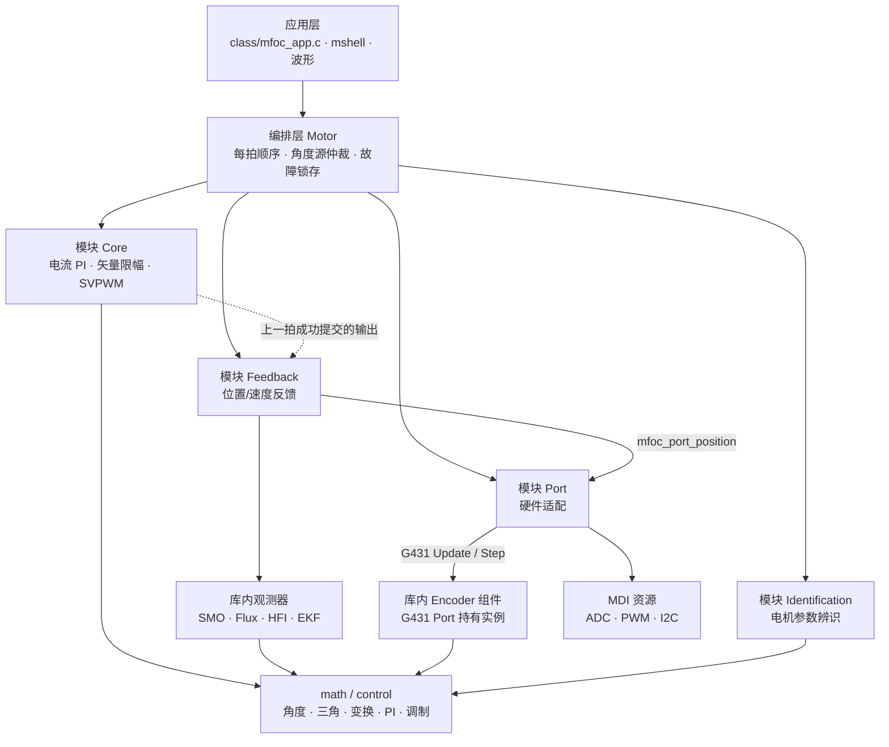
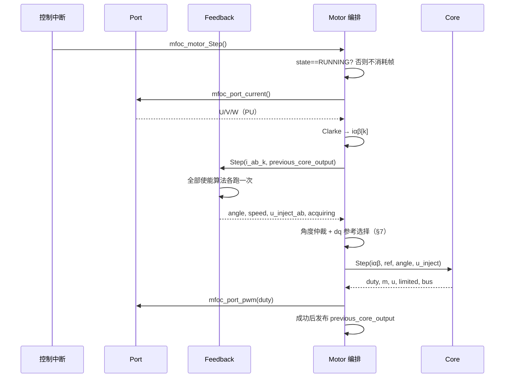
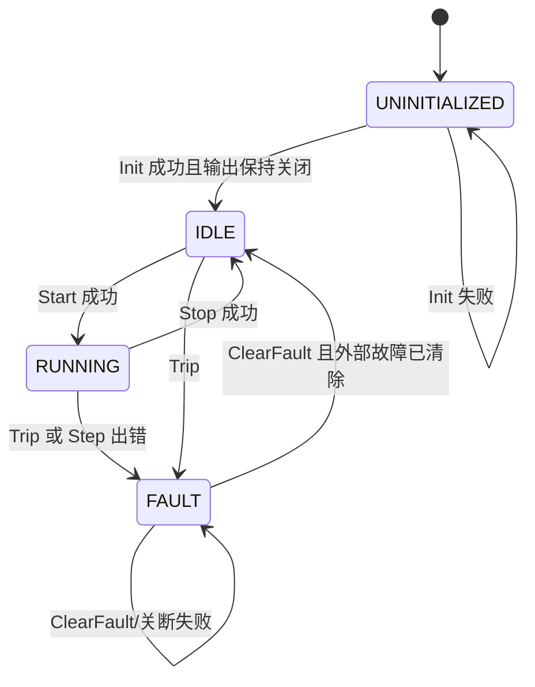

# MFOC Framework 总览

本文定义 MFOC 的**骨架**：有哪些层，层与层之间只在哪几个结构体上交互，每个模块向协作者提供哪些物理量、要求它交回什么、在什么上下文、以什么节奏调用、失败如何处置。算法内部的推导、整定与台架验证不在本文范围内，按 §12 分篇展开。本文只描述已实现并存在于代码中的边界；尚未落地的能力以 TODO 标注，不写成既定设计。

**一分钟版**：Motor 是唯一的编排者。常规闭环每拍读电流，向 Feedback 取角速，把角度和电流参考交给 Core 算 duty，再交给 Port 提交。Feedback 发布配置选中的位置源，Motor 按运行阶段决定何时采用它。Identification 负责测出电机参数。Flux 和 SMO 只需本拍电流与上一拍模型电压即可推进各自的估计。

阅读顺序：§1–§2 建立坐标系；§3–§6 逐个看四个模块的接口；§7–§9 看一次周期怎么走；§10–§12 看生命周期、配置与后续分工。

## 1. 骨架：四层与四个模块



实线表示调用或依赖。虚线表示 Motor 将上一拍成功提交的 Core 输出传给 Feedback，供观测器重建前一区间的模型电压。物理位置的前台更新与中断读取共用板级持有的位置实例。见 [Encoder 模块](modules/encoder.md)。

| 层 | 代表文件 | 允许依赖 | 禁止 |
| --- | --- | --- | --- |
| 应用 | [`class/mfoc_app.c`](../../class/mfoc_app.c) | 全部公共 API | 自己算控制量、直接写外设寄存器 |
| 编排 | [`mfoc_motor.c`](../motor/src/mfoc_motor.c) | 各模块、OpenLoop、SensorlessStart、Port | 位置算法内部实现细节 |
| 模块 | [`mfoc_feedback.c`](../motor/src/mfoc_feedback.c)、[`mfoc_core.c`](../core/src/mfoc_core.c)、[`mfoc_identification.c`](../identification/src/mfoc_identification.c)、[`mfoc_port.h`](../port/include/mfoc_port.h) | 叶子算法、math、板级 Port 契约 | MDI 由目标适配层使用 |
| 叶子 | [`position/src/*.c`](../position/src)、[`control/src/*.c`](../control/src)、[`math/src/*.c`](../math/src) | math、模型常数 | Port/Motor/Core、阻塞等待、全局变量 |

四个模块并不等价，写文档和读代码时不要混为一谈：

- **可替换模块**有两个。Feedback 内部是算法组合，换观测器只改它；Port 是板级实现，换板子只改它。两者对外接口不变。
- **框架内置模块**有两个。Core（电流环）与 Identification（电机参数辨识）没有外部实现，框架直接调用；它们只需遵守各自的输入输出接口，不接受替换。

两点例外，写在这里以免读代码时误判：

- 辨识叶子接受 `const mfoc_core_output_t *` 作为只读入参（复用结构，不调用 Core API），见 [`mfoc_identification_algorithms.h`](../identification/include/mfoc_identification_algorithms.h)。
- G431 的 [中断入口](../../target/stm32g431/mfoc_motor_irq.c) 绑定应用实例与 ADC 帧握手，按配置执行应用波形和耗时统计。库通过 `mfoc_motor_Step()` 提供单拍控制入口。

## 2. 三条全局约定

### 2.1 标幺与基值

所有跨模块数值都是标幺值，基值来自 [`mfoc_motor_config.h`](../mfoc_motor_config.h)，可由辨识结果替换。电流基值是**相电流峰值**，Clarke 为幅值不变形式。

| 量 | 基值 | PU 定义 | 说明 |
| --- | --- | --- | --- |
| 电流 | `Ib` = 相电流峰值标度 3.5 A | `i/Ib` | MFOC 的归一化参考值，不代表特定电机额定电流；`iαβ`、`idq`、`i_ref` 统一口径 |
| 电压 | `Vb` = 固定直流母线参考值 12 V | `u/Vb` | MFOC 的归一化参考值；Core 的 dq 电压与注入电压都用此基 |
| 母线 | 同 `Vb` | `Vdc/Vb` | 只用于限幅半径与 `V/Vdc` 归一化 |
| 电角速度 | `ωb` = 2π·400 Hz | `ωe/ωb` | MFOC 的固定电角速度归一化参考值，不是电机额定转速；**不是机械转速** |
| 角度 | 1 周 = 2³² | BAM32 | 无符号回绕，差值用 `mfoc_angle_diff` |
| 电阻 | `Rb = Vb/Ib` | `Rs/Rb` | 由三个独立基值导出 |
| 电感 | `Lb = Rb/ωb` | `L/Lb` | |
| 磁链 | `ψb = Vb/ωb` | `ψ/ψb` | |
| 时间 | `tb = 1/ωb` | — | 观测器的归一化时间 |
| 惯量 | `Jb = Tb·tb/ωmb` | `J/Jb` | |
| 占空比 | — | `[0,1]` | Core 输出，Port 提交 |

`mfoc_motor_params_t` 是这套基值上的模型常数载体：`pole_pairs`、`rs`、`ld`、`lq`、`flux`、`inertia`。它在 Init 时一次性换算、运行期不变；要变更必须停机后走 `mfoc_feedback_SetMotorParamModel` 重建。

### 2.2 角度、速度、时间

- 角度一律 `mfoc_angle_t`（BAM32）。求差用 `mfoc_angle_diff`，得到 `[-0.5, 0.5)` 周；不要自己相减后强转符号。
- 速度统一定义为**电气角速度 PU**，符号即转向。机械换算是编码器模块内部的事（机械转速 × 极对数 ÷ `ωb`），其它算法不得假设自己拿到的是机械量。
- 控制中断频率由 `MFOC_MOTOR_RUN_FREQ_HZ` 给定，电流环、电流采样、HFI 载波与参数辨识共用它，各自的系数在编译期或 Init 时按它换算。速度环频率 `MFOC_SPEED_RUN_FREQ_HZ` 独立设置，框架据此派生“每几步更新一次速度”。应用应将观测器的 `sample_hz` 设为实际控制频率。SMO 和 Flux 按传入值计算离散系数，Init 不核对硬件节拍。
- 一个控制拍内的输入输出约定：当前拍电流是 `i[k]`，可用电压是**上一区间**的 `u[k-1]`，覆盖采样间隔 `[k-1, k)`。两者的时间对齐由调用者保证。

### 2.3 调用上下文与所有权

| 上下文 | 入口 | 规则 |
| --- | --- | --- |
| 控制中断 | `mfoc_motor_Step` → `feedback_Step` / `core_Step` | 最高优先级、不可重入；只做运算，不访问总线、不打印、不等待 |
| 前台 | `mfoc_motor_Run`、`mfoc_port_position_run`、命令类 API | 可以有界阻塞；负责慢速外设（I2C）与阶段推进 |
| 停止态前台 | `Init`、`SetMotorParamModel`、辨识准备 | 允许预计算系数、重建状态 |

所有权：应用拥有 `mfoc_motor_t` 实例；Motor 拥有 Feedback、Core、OpenLoop、SensorlessStart、Identification 子对象；板级 Port 持有物理位置组件（G431 为 Encoder），Feedback 只持有无感观测器；算法只拥有自己的状态。**没有任何模块保存 ADC/PWM/I2C 句柄**，硬件只在 Port 内部按编译期 MDI 绑定访问。

命令类 API 与 ISR 的互斥由应用负责，库不关中断。

普通操作用 `mfoc_result_t` 报告成功或具体错误。非阻塞操作用 `mfoc_fsm_rt_t` 告知调用方如何继续。独立构建默认使用 MFOC 的六值枚举。已集成 perfc 的工程可统一定义 `MFOC_USE_PERFC_FSM=1`，由公共头包含 `perf_counter.h` 并声明 `typedef fsm_rt_t mfoc_fsm_rt_t;`。下表的六个名称在该模式下直接映射到 perfc 枚举项。G431 工程已启用此配置。[公共类型](../math/include/mfoc_types.h)

| 返回值 | 数值 | 调用方的处理 |
| --- | ---: | --- |
| `MFOC_FSM_FAILED` | −1 | 本次操作失败，进入错误处理 |
| `MFOC_FSM_COMPLETE` | 0 | 本次操作结束，可停止轮询 |
| `MFOC_FSM_ONGOING` | 1 | 按正常节拍再次调用，继续推进 |
| `MFOC_FSM_WAIT_FOR_OBJECT` | 2 | 等待指定对象满足条件，例如事件置位 |
| `MFOC_FSM_ASYNC` | 3 | 操作异步执行，按该接口约定稍后查询结果 |
| `MFOC_FSM_WAIT_FOR_RESOURCE` | 4 | 等待所需资源可用，例如缓冲区释放后再试 |

<a id="feedback"></a>

## 3. 模块 A：Feedback（位置/速度反馈）

Feedback 在每个需要反馈的控制拍返回电角度、标幺电速度及启用的注入请求。物理位置由 Port 提供。模型观测器使用本拍电流和由上一拍 duty、母线重建的电压。选源、字段单位、调用时机及失败处置见 [Feedback 接口](modules/feedback.md)。

### 3.1 接入方式

Feedback 持有启用的无感观测器实例。物理位置启用时，它调用 `mfoc_port_position(&next.angle, &next.speed)`。由板级决定这两个量如何取得。编译选项 `MFOC_FEEDBACK_BACKEND` 决定 Feedback 发布哪一路角速，Motor 的运行阶段决定本拍何时采用该反馈。见 [Feedback 公共头文件](../motor/include/mfoc_feedback.h) 和 [G431 Encoder 接线](modules/encoder.md)。

### 3.2 框架提供给算法的物理量

| # | 物理量 | 载体 | 单位/定义 | 来源 | 何时不可用 |
| --- | --- | --- | --- | --- | --- |
| 1 | 定子电流 `iα`、`iβ`（采样拍 k） | `mfoc_feedback_input_t::i_ab_k` | `I/Ib`，幅值不变 Clarke | Port 三相帧 → Motor `mfoc_clarke` | Motor 取帧失败直接 Trip；单独调用 Feedback 可传 NULL 表示缺流 |
| 2 | 定子电压 `uα`、`uβ`（区间 k-1→k） | 由 `previous_core_output` 反解，见下 | `V/Vbase`，理想平均电压 | 上一拍**成功提交**的 Core 输出（`duty` + `bus`） | 首拍、上一拍提交失败、上一拍是辨识电压直出 |
| 3 | 电机模型常数 | `mfoc_motor_params_t`（Init 传入） | `Rs/Ld/Lq/ψ/J` 均为 PU | 配置或辨识结果 | 运行期不可变 |
| 4 | 时基与基值 | `*_cfg.sample_hz`、`speed_base_hz` | Hz | 编译配置 | Init 时固定 |
| 5 | 算法私有配置 | `mfoc_feedback_cfg_t::<algo>` | 各自定义 | 应用 | Init 时固定 |
| 6 | 统一物理位置 | `mfoc_port_position(angle, speed)` | BAM32 电角度 + 电角速度 PU | 板级位置提供者；G431 使用库内 Encoder | 提供者返回非 OK；不暴露机械样本 |

第 2 项是理解整个无感框架的关键：框架**没有相电压采样通道**，`uαβ[k-1]` 由上一拍的占空比和母线快照按理想逆变器重算：

```c
mfoc_modulation_ModelVoltageAlphaBeta(&previous->duty, previous->bus, &u);
```

它不含死区、管压降、母线纹波，允许超过 1 PU。因此观测器的模型误差等于"实际器件行为"与"理想平均电压"之差，这一项误差必须在算法专题里单独评估，不能指望框架补偿。

缺少上一区间电压时，Feedback 复位 SMO、Flux、EKF 的历史并清零各自的输出缓存。选中这些后端时，本拍返回 `INVALID_STATE`。POSITION 仍按 Port 的结果发布，HFI 有本拍电流即可开始注入。

### 3.3 算法必须交回的量

| 输出 | 类型 | 单位 | 消费者 |
| --- | --- | --- | --- |
| 电角度 | `mfoc_angle_t` | BAM32 | Core 的 Park/iPark；无感接管的捕获与混合 |
| 电角速度 | `mfoc_scalar_t` | `ωe/ωb` | 速度 PI；无感接管的窗口判据 |
| 有效性 | `bool valid` 或 `mfoc_result_t` | — | Feedback 的仲裁门控（§3.4） |
| 扩展量（可选） | 如 `bemf`、`u_inject_ab`、`state` | 各自定义 | 注入通道、诊断与波形 |

硬性约束：

- 只写自己的实例和传入的 `*_output_t`；不调用 Port/Core/其它算法；不分配、不阻塞。
- 角度必须对应本拍电流 `i[k]` 的时刻。编码器用 tick 外推到当前时刻；模型类算法用 `u[k-1]` 从 `k-1` 状态推进到 `k`。允许延后一拍以上的算法必须在专题里声明。
- `valid` 表示"这一拍可以作为控制角"，不是"算法已收敛"或"已可接管"。接管策略属于 Motor/应用（§7），不属于算法。

所有无感后端共同遵守的形状就是下面三个函数（编码器与 HFI 的差异见 §3.6）：

```c
/* 框架对一个位置后端的全部要求，除此之外不调用你任何东西 */
mfoc_result_t mfoc_X_Init(X_t *x, const X_cfg_t *cfg,
                          const mfoc_motor_params_t *model);
void          mfoc_X_Reset(X_t *x);            /* 电压缺失时被调用 */
void          mfoc_X_Step(X_t *x, const mfoc_ab_t *i_k,
                          const mfoc_ab_t *u_k_1, X_output_t *out);
/* out = { angle     BAM32，对应 i[k] 的时刻
 *         speed     ωe/ωb
 *         valid     本拍可否作为控制角 }
 */
```

### 3.4 仲裁、影子观测与失败语义

- **每次调用 Feedback** 都处理全部已使能的位置源和观测器。backend 决定哪一路角速可发布，其他启用的观测器各自维护历史及影子输出。
- POSITION 须由 Port 返回 `OK`。SMO、Flux、EKF 须有模型输入且叶子输出 `valid`。HFI 须有本拍电流且未进入 `FAILED`，获取位置时可带 `acquiring` 发布注入。所选后端未满足条件时，`mfoc_feedback_Step` 返回非 `OK`，调用方的整份 `output` 保留原值。
- Motor 的处置按所处阶段不同，这是最容易读错的一处：

| 阶段 | Feedback 返回非 OK 时 |
| --- | --- |
| ACQUIRE 已捕获或常规闭环 | Trip，锁存 `MFOC_MOTOR_FAULT_FEEDBACK` |
| 强拖（`openloop_active`） | 仅诊断，控制角来自 OpenLoop |
| 无感 RAMP / 尚未捕获的 ACQUIRE | 仅诊断；返回码交给接管状态机判断是否继续等待 |

- 影子输出目前没有公开访问器（`mfoc_feedback.h` 不提供 getter），诊断代码直接读 `motor.feedback.<algo>_output`。这是"框架内可见、非稳定 API"；若要把影子观测做成产品功能，应补只读访问器而不是继续暴露结构体。
- HFI 使能后，即使在编码器闭环下也会计算注入请求。只有 Feedback 成功发布整份输出时，Motor 才将本拍 `u_inject_ab` 交给 Core。
- HFI 作为 backend 且尚未锁定时会置 `acquiring`：Motor 强制 `i_ref = 0` 并暂停速度环，把整拍让给注入，直到算法报 `valid`。

### 3.5 调用节奏

| 职责 | 入口 | 上下文 | 节奏 | 允许的耗时操作 |
| --- | --- | --- | --- | --- |
| 慢速采样（G431 编码器） | Motor_Run → `mfoc_port_position_run` → Encoder_Update | 前台 | 板级 1 ms | 板级 I2C 读取，Encoder 计算速度、滤波并发布双缓冲 |
| 每拍观测与仲裁 | `mfoc_feedback_Step` | 控制 ISR | 每个有效电流帧 | 仅运算 |
| 系数预计算 | `mfoc_feedback_Init` | 停止态前台 | 一次 | 三角表、离散系数 |
| 模型重建 | `mfoc_feedback_SetMotorParamModel` | 停机时 | 参数更新时 | 全部模型类算法重算；编码器零位与 HFI 保留 |
| HFI 序列复位 | `mfoc_feedback_HfiStart` | 停止态前台 | 调用 Motor 的 HfiStart 时 | 清载波序列 |
| 零位标定 | Motor_Run → `mfoc_port_position_calibrate_zero` | 固定角保持期间 | 一次 | 板级读取，再调用位置组件标定 |

规则：**ISR 内不得访问总线**。带 I2C 的传感器必须在 `Run` 里采，ISR 只读发布好的快照——编码器就是这样做的，新增传感器类反馈必须照此拆分。

### 3.6 现有后端契约对照

| 算法 | 编译开关（默认） | 每拍入口 | 每拍输入 | 输出 | `valid` 的含义 | 前台服务 |
| --- | --- | --- | --- | --- | --- | --- |
| 物理位置（G431 为 Encoder） | `..._ENABLE_POSITION`（1） | Port → `mfoc_encoder_Step` | 已发布样本 + 当前 64 位 tick | angle、speed + 返回码 | 已有未过期样本 | Port 采样 → `mfoc_encoder_Update` |
| SMO | `..._ENABLE_SMO`（1） | `mfoc_smo_Step` | `i[k]`、`u[k-1]` | angle、speed、bemf、valid | 反电势/速度非零 | 无 |
| Flux | `..._ENABLE_FLUX`（0） | `mfoc_flux_Step` | `i[k]`、`u[k-1]` | angle、speed、valid | 磁链非零 | 无 |
| HFI | `..._ENABLE_HFI`（0） | `mfoc_hfi_Step` | `i[k]`、`u[k-1]` 可为 NULL | angle、speed、`u_inject_ab`、valid | 载波已锁定（启用极性时含极性） | `HfiStart` 复位 |
| EKF | `..._ENABLE_EKF`（0，仅 FLOAT） | `mfoc_ekf_Step` | `i[k]`、`u[k-1]` | angle、speed、valid | 后验速度/协方差合格 | 无 |

缺省配置使用 SMO 作为 backend，同时开启物理位置。物理位置可用于影子观察；选择 `MFOC_FEEDBACK_POSITION` 后则用于控制，旧 ENCODER 宏名称保持兼容。

<a id="new-feedback-backend"></a>

### 3.7 新增一个无感后端的最小改动清单

新增编码器或霍尔提供者只需在板级实现统一位置 Port，实例由板级持有；Feedback 和 Motor 无需增加传感器成员。以下清单适用于库内无感估计器。

1. 头文件只依赖 `mfoc_angle.h`、`mfoc_motor_params.h`（必要时 `mfoc_motor_config.h`），不得 include port/motor/core。
2. 定义三件套：`X_t`（纯状态、无句柄）、`X_cfg_t`（Init 一次性）、`X_output_t { angle; speed; valid; }`。
3. `mfoc_X_Init(X_t*, const X_cfg_t*, const mfoc_motor_params_t*)`：先算到临时变量，全部校验通过再提交，失败不改实例。
4. `void mfoc_X_Reset(X_t*)`：清历史、保系数——电压缺失时框架会调用它。
5. `void mfoc_X_Step(X_t*, const mfoc_ab_t *i_k, const mfoc_ab_t *u_k_1, X_output_t*)`：只读入参、只写 out 与自有状态。
6. 加 `MFOC_FEEDBACK_ENABLE_X`（默认 0）与 `MFOC_FEEDBACK_X` 枚举，并在 `mfoc_feedback.h` 的 `#error` 检查里补一条"backend 必须对应已使能算法"。
7. 接线三处：`mfoc_feedback_t` 加实例与 output 成员；`Init`/`SetMotorParamModel` 加 init 与重建；`Step` 加调用与 backend 门控（状态 + valid）。
8. 测试：算法级数值用例 + feedback 级"影子运行"与"门控失败"用例，模型类必须覆盖"电压缺失 → Reset 后自恢复"。

<a id="core"></a>

## 4. 模块 B：Core（电流环）

> 一句话契约：给我 dq 参考、`iαβ[k]`、角度和注入电压，我给你三相 duty 与限幅标志；
> 我不问你角度从哪来。

| 方向 | 内容 | 载体 |
| --- | --- | --- |
| 入 | 本拍电流 `iαβ` | `mfoc_core_input_t::i` |
| 入 | dq 电流参考 | `mfoc_core_input_t::ref` |
| 入 | 本拍电角度 | `mfoc_core_input_t::angle` |
| 入 | 静止系注入电压 | `mfoc_core_input_t::u_inject_ab`（零即关闭） |
| 出 | Park 后的实测 dq 电流 | `mfoc_core_output_t::i` |
| 出 | 限幅后的 dq 电压（含注入） | `mfoc_core_output_t::u` |
| 出 | αβ 调制度 `V/Vdc` | `mfoc_core_output_t::m` |
| 出 | 三相 duty `[0,1]` | `mfoc_core_output_t::duty` |
| 出 | 本拍母线快照、是否限幅 | `bus`、`limited` |

每拍顺序固定：一次 `sincos` → Park → d/q 两路 PI → 叠加注入（非零才做）→ 圆形电压限幅（半径 `MFOC_CORE_M_MAX × bus`）→ 限幅后回写 PI 积分 → 归一化到 `V/Vdc` → iPark → SVPWM。

边界：Core 不做采样、不选角度、不判故障、不开关 PWM；母线系数由 `Init` 或 `SetBus` 提供，何时更新是应用/Motor 的策略。限幅半径随母线变化，`SetBus` 失败必须保留旧系数。

<a id="identification"></a>

## 5. 模块 C：Identification（电机参数辨识）

Identification 是电机参数辨识模块，用受控激励测出 `Rs`、`Ld`、`Lq`、`ψ`、`J`，产出一个 `mfoc_motor_params_t`。作为框架内置模块，它没有外部实现、也不接受替换，只在实验期间占用控制通路。

实验有两条激励通路，由 stage 的 bit4/bit5 选择（低 4 位标识具体阶段）：

| 通路 | 标志 | 怎么驱动电机 | 测什么 |
| --- | --- | --- | --- |
| 电压直出 | `CONTROL_VOLTAGE` | 算法给 `modulation_ab`（`V/Vdc`），直接进 SVPWM，**绕过 Core** | Rs、Ld、Lq |
| 虚拟闭环 | `CONTROL_VIRTUAL` | 算法给 `i_ref` 和自己的虚拟角度，走正常 Core | 磁链、惯量 |

| 方向 | 内容 | 载体 |
| --- | --- | --- |
| 入 | 本拍电流 `i[k]` | `mfoc_identification_input_t::i_ab_k` |
| 入 | 上一拍请求电压 `u[k-1]` | `...::u_ab_previous`（Motor 由 duty×bus 记录） |
| 出 | `i_ref` / `angle`（VIRTUAL） | `mfoc_identification_output_t` |
| 出 | `modulation_ab`（VOLTAGE） | 同上 |
| 出 | 结果模型 | `mfoc_identification_GetResult` → `mfoc_motor_params_t` |

它与框架其余部分的关系：

- 实验激活时 **Feedback 完全不运行**，观测器历史随之失效；回到常规控制后由"电压缺失 → Reset"机制自动重建，这是有意为之而不是副作用。
- VOLTAGE 阶段会把 `previous_core_output_valid` 置 false：电压直出没有 Core 输出，不能拿它当模型输入。
- 前台 `Run` 推进阶段（带超时），ISR 只消费当前阶段；`stage_done` 是两者唯一的握手。
- 结果只在 `DONE` 后由 `GetResult` 拷贝；拿到结果后停机、调 `mfoc_feedback_SetMotorParamModel` 才是"生效"——辨识只产出参数，不负责让参数进入控制通路。
- 现状：Rs 流程完整；Ld/Lq 的脉冲调度与旋转准备仍为 TODO；磁链有独立叶子但尚未接到经 Motor 启动的路径。本文只描述已实现的边界。

## 6. 模块 D：Port（硬件适配）

> 一句话契约：提供 PU 电流、PU 母线、统一电角度/速度及时钟，把 duty 交到硬件。完整契约见 [Port 文档](port-contract.md)。

| 接口 | 必须回答的问题 | 上下文 |
| --- | --- | --- |
| `mfoc_port_init(cfg)` | 按共同基值准备换算、校零并初始化位置提供者 | Motor_Init 内调用 |
| `mfoc_port_current` | 有没有新鲜完整的三相帧？换算成 `I/Ib` | 控制 ISR |
| `mfoc_port_bus` | 已发布的母线值（`Vdc/Vb`） | 控制 ISR 或前台 |
| `mfoc_port_position_run` | 按采集周期更新位置实例 | 前台 |
| `mfoc_port_position` | 电角度 BAM32 + 电角速度 PU，不读慢速总线 | 控制 ISR |
| `mfoc_port_position_calibrate_zero` | 根据保持角标定位置零位 | 固定角保持前台 |
| `mfoc_port_tick` / `_frequency` | 同源稳定的 64 位 tick / 32 位 Hz | ISR / 前台 |
| `mfoc_port_pwm` | 只写三相 duty，不改变输出使能 | 控制 ISR |
| `mfoc_port_pwm_start` | 初始 duty 生效后使能输出 | 启动前台 |
| `mfoc_port_pwm_stop` | 关相输出，保留采样触发 | 任意 |

板级负责 ADC 触发与 PWM 更新时序、启动时先写比较值再开门、电流极性与 ADC 标度，并保证校零期间无其他帧消费者。电流和母线的板级标度见 [G431 Port 实现](../../peripheral/stm32g431/mfoc/mfoc_port.c)。Port 不替 Motor 决定启动时机，也不清除硬件故障锁存。

## 7. 角度源仲裁：这一拍用谁的角度

Motor 在每个 Step 里按固定优先级决定角度来源，顺序就是代码里的分支顺序：

| 优先级 | 条件 | 本拍角度来自 | Feedback 是否运行 |
| --- | --- | --- | --- |
| 1 | 辨识阶段标志非 INACTIVE | 辨识虚拟角或直接调制 | 不运行 |
| 2 | `openloop_active`（强拖） | OpenLoop 积分角 | 运行（仅诊断） |
| 3 | `sensorless_start.state != NONE` | RAMP 用 OpenLoop 角；ACQUIRE 捕获前用 OpenLoop 角，捕获后用 `feedback.angle + offset` | 运行（提供观测角） |
| 4 | `hold_active` 且非强拖、非无感 | OpenLoop 固定角 | **不运行**（纯对齐） |
| 5 | 正常闭环 | `feedback.angle`（所配置 backend） | 运行（决定控制角） |
| 6 | `acquiring`（HFI 未锁定） | `feedback.angle` | 运行；`i_ref` 强制清零、速度环暂停 |

ACQUIRE 捕获成功后，Motor 按 `MFOC_START_BLEND_TURNS_S` 将 `forced - observed` 的偏移量逐拍缩至零，随后用 `mfoc_pi_Track` 衔接速度环。速度连续处于窗口内满 `MFOC_START_STABLE_MS` 后，启动状态回到 NONE。[捕获判据与超时处置](modules/feedback.md#handover) · [接管参数](../mfoc_motor_config.h)

## 8. 一拍 Step 的时序



编号版（与代码一一对应）：

1. `state != RUNNING` → 返回 `INVALID_STATE`，不读帧。
2. 读新鲜三相帧，Clarke 成 `iαβ[k]`；读失败 → Trip(`SAMPLE`)。
3. 辨识激活则走 §5 分支，跳过 4–6 的常规控制，直接到 PWM 提交。
4. （非纯对齐时）`mfoc_feedback_Step`：模型类先用 `previous_core_output` 反解 `uαβ[k-1]`，再逐算法运行，最后由 backend 门控。
5. 角度仲裁与参考选择：速度环每 `speed_divider` 拍执行一次。
6. `mfoc_core_Step`：Park → PI → 注入 → 限幅 → iPark → SVPWM。
7. `mfoc_port_pwm(duty)` 提交。
8. **提交成功后**才发布 `previous_core_output`；失败则 Trip(`PWM`) 且不发布。
9. 速度环分频计数递减；返回状态，`irq_result` 记录诊断。

启动首拍没有上一拍电压。无感强拖路径允许模型观测器复位，并以 OpenLoop 角完成首次 PWM 提交。下一拍才有可用的模型电压，估计何时有效取决于具体算法。直接用模型后端进入常规闭环时，首拍无效会触发反馈故障。

## 9. 前台 Run 的职责

`mfoc_motor_Run` 每个前台循环调用一次，先调用 `mfoc_port_position_run`（使能物理位置时），再推进辨识或处理对齐超时。辨识分支提前返回前也已完成位置服务。位置读取失败不会跳过对齐到期、校准结果处理和停机。Motor 保持计时与辨识阶段超时都使用 Port 的 64 位 tick。辨识从首次前台轮询该阶段时开始计时，后续轮询沿用该起点。ISR 已完成采样时，前台优先处理完成事件，再为下一阶段计时。

在 `mfoc_identification_Run` 中，`MFOC_PT_BEGIN(id->run_pt)` 和 `MFOC_PT_END()` 标出前台流程的范围。每个实例各自保存恢复点 `run_pt`。进入一个阶段时先记录起始 tick，然后在 `MFOC_PT_WAIT_UNTIL` 等待采样完成、实验中止或阶段超时。条件未满足时返回 `MFOC_FSM_ONGOING`，下次调用直接重查条件，因此采样停滞也会按原截止时间退出。G431 将这三个宏映射到原生 perfc PT，独立构建使用 C11 实现。[前台状态机](../identification/src/mfoc_identification.c) · [PT 接口](../mfoc_pt.h)

空闲时调用 Run 返回 `MFOC_FSM_COMPLETE`，表示调用方可以停止轮询。实验状态由 `mfoc_identification_GetStatus` 查询，只有到达 `MFOC_IDENTIFICATION_DONE` 时，`mfoc_identification_GetResult` 才会写入模型。[辨识接口](../identification/include/mfoc_identification.h)

它通常不 Trip，只有两处会锁存故障：零位标定失败（`FEEDBACK`）与辨识阶段报错（`EXTERNAL`）。应用仍需自己做：保证 Run 的调用频率、在 ISR 里调用 Step、决定母线更新节奏、确认物理故障消失后调 `ClearFault`。

## 10. 生命周期、故障与数据所有权



ALIGN、强拖、无感启动阶段不是主状态，而是 `hold_active`、`openloop_active`、`sensorless_start.state` 三个附加标志（§7）。

| 故障位 | 触发点 |
| --- | --- |
| `SAMPLE` | 电流帧读取失败 |
| `OVERCURRENT` | 预留位：框架不自行判定，由应用调 `Trip` 置位（当前仓库无调用点） |
| `FEEDBACK` | 常规闭环下 Feedback 非 OK；零位标定失败 |
| `MATH` | Core 复位等数学路径失败 |
| `PWM` | duty 提交或关断失败 |
| `EXTERNAL` | 辨识阶段报错等外部原因 |

关键字段的写者/读者：

| 字段 | 写者 | 读者 | 说明 |
| --- | --- | --- | --- |
| `state`、`faults` | Motor API / ISR | 应用 | volatile，但两者不是原子对 |
| `i_ref` | 命令、速度环、辨识 | Core | 模式切换时保留上一次值 |
| `previous_core_output(_valid)` | Step 提交成功后 | Feedback | Stop/Trip 置无效 |
| `previous_voltage_ab` | Step（辨识使能时） | 辨识 | 上一拍请求电压 |
| `core`（PI 积分、限幅半径） | Core | — | 只有 Core 自己改 |
| `feedback.*` | Feedback 与各算法 | 应用诊断 | 影子输出无访问器（§3.4） |
| `speed`、`speed_count` | 速度环 | Motor | 分频控制 |
| `identification.stage` | 前台 Run / ISR | 两侧 | volatile + `stage_done` 握手 |

## 11. 配置与编译边界

[`mfoc_config.h`](../mfoc_config.h) 管功能与算法选择，[`mfoc_motor_config.h`](../mfoc_motor_config.h) 管电机规格与基值，板级标度由目标的 Port 实现提供。

| 配置 | 作用 | 现状 |
| --- | --- | --- |
| `MFOC_NUMERIC=float/fixed` | 数值后端，二选一 | EKF 仅支持 FLOAT |
| `MFOC_MOTOR_RUN_FREQ_HZ` | 控制中断、电流环、采样、HFI、辨识共用频率 | 默认 20000；必须能被目标 PWM 生成 |
| `MFOC_SPEED_RUN_FREQ_HZ` | 速度环频率，决定 `MFOC_SPEED_LOOP_DIVIDER` | 默认 1000；0 关闭速度模式 |
| `MFOC_FEEDBACK_ENABLE_*` | 哪些位置源/观测器参与运行 | POSITION、SMO 默认开 |
| `MFOC_FEEDBACK_BACKEND` | 谁的输出被采纳 | 默认 SMO；必须对应已使能算法，`#error` 兜底 |
| `MFOC_CORE_M_MAX` | 电压矢量相对母线的上限 | 0.55，留 PWM 余量 |
| `MFOC_IDENTIFICATION_ENABLE` | 辨识流程与相关字段 | 默认 0；关闭后实例成员一并消失 |
| `MFOC_ISR_MEASURE` | 中断计时统计 | 仅调试构建开启，会引用应用对象 |

两点容易踩：`MFOC_FEEDBACK_NONE` 只适用于纯强拖或辨识构建，常规闭环会因"无后端"直接 Trip；编译开关会改变结构体成员，各编译单元必须使用同一份配置。

## 12. 后续专题与本文的交接点

| 专题 | 必读章节 | 需要回答的问题 |
| --- | --- | --- |
| [Feedback 接口与无感接管](modules/feedback.md) | §3.4、§7 | 编译期选源、输出有效性、强拖到观测角的捕获与失败处置 |
| [Flux 非线性磁链观测器](modules/flux.md) | §3.2、§3.3 | 磁链模型与饱和、PLL 带宽、低速与零速限制 |
| [SMO 滑模反电势观测器](modules/smo.md) | §3.2、§3.3 | 边界层、速度窗、相位补偿、与采样延迟的关系 |
| EKF | §3.2、§3.3 | Q/R/P0 的来源、可观测性、FLOAT 约束 |
| HFI | §3.4、§7 | 注入与 `acquiring` 的配合、极性辨识、失败后的收场 |
| [Encoder 位置组件](modules/encoder.md) | §3.5、§6 | 前台采样周期、零位标定、超时判定 |
| 参数辨识 | §5 | 实验所有权、结果提交、模型的停机重建 |
| 移植与板级 | §6、§11 | 采样/PWM 时序、标度与极性、中断预算 |
