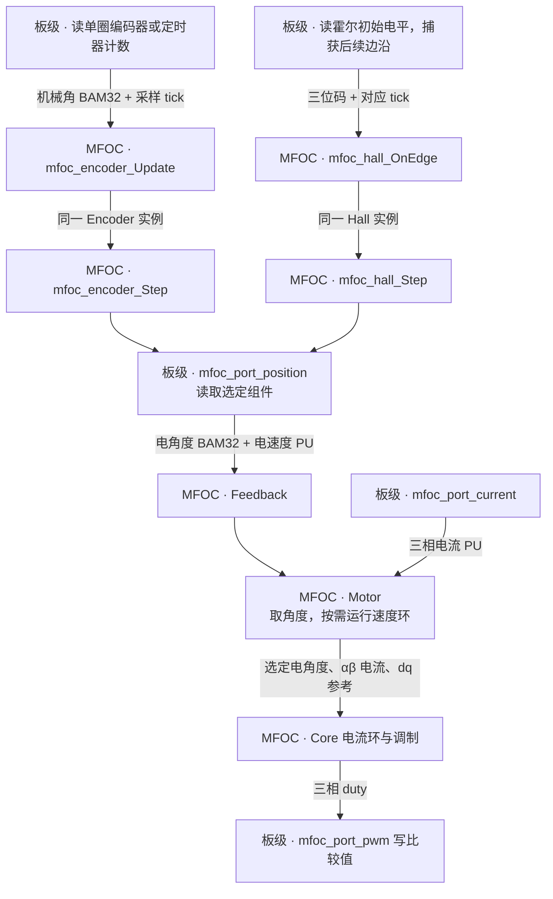

# MFOC 硬件接口移植指南

本文给板级移植者使用。MFOC 发布公共 Port 头和一份移植模板，每个功率板提供自己的实现。G431 的实现依赖这块板的 ADC、PWM、I2C 与时钟，随目标工程编译。接口语义见 [mfoc_port.h](../port/include/mfoc_port.h)，可对照 [G431 实现](../../peripheral/stm32g431/mfoc/mfoc_port.c)。

## 新板从哪里开始

1. 将 [mfoc_port_template.c](../port/template/mfoc_port_template.c) 复制为板级目录的 `mfoc_port.c`。模板中的 `board_*` 表示需要接入的驱动操作，可直接替换成项目已有的有类型调用。
2. 接好相电流采样和母线测量，明确电流方向、零偏、增益、母线分压。实现同源的 64 位 tick 和 32 位 Hz。把三相 duty 接到定时器，确认初始比较值生效后再打开输出。
3. 启用物理位置时，按第 4 节框图选一路位置源，再照第 5 节的接线表和示例填写模板。编码器输入机械角，霍尔输入三位电平和边沿捕获时刻。两者向 Feedback 提供相同单位的电角度和速度。
4. 将库源文件和**本板的一份 Port 实现**加入同一构建。仓库的 `mfoc.mk` 提供库源清单，G431 在 `MFOC_TARGET_SOURCES` 中单独指定自己的 `mfoc_port.c` 和中断入口。可复制的模板留作源文件样例。见 [G431 目标配置](../../target/stm32g431/target.mk)。
5. 板级先准备时钟、采样触发，保持相输出关闭，再由应用调用 `mfoc_motor_Init()`。在前台调用 `mfoc_motor_Run()`，在每次电流帧完成后的控制中断调用 `mfoc_motor_Step()`。台架核对采样点、PWM 更新点及有效输出的先后关系。

## 1. 边界与对象归属

Port 是一组编译期直接绑定的函数，连接一个静态绑定的功率级。库内使用 PU 电流、电压、速度及 BAM32 电角度；板级负责硬件采集、物理量换算、位置提供器和 PWM 提交时序。

| 对象或数据 | 拥有者 | 职责 |
|---|---|---|
| `mfoc_motor_t` | 应用 | 编排 Feedback、Core、速度环、启动及辨识；不保存 ADC/PWM/传感器句柄 |
| `mfoc_feedback_t` | Motor | 拥有启用的 SMO、Flux、HFI、EKF 算法状态；按编译配置选择角度、速度及注入输出 |
| `mfoc_core_t` | Motor | 坐标变换、电流控制、电压约束、调制与 duty |
| `mfoc_encoder_t` | G431 Port | 位置处理组件的实例；包含测速、滤波、零位和发布样本 |
| `mfoc_mdi_port_t s_port` | G431 单功率级适配 | 组合 Encoder、采集周期、时刻、电流零偏、换算系数和电压基值 |
| ADC、PWM、I2C、原始时基及故障门控 | 板级 MDI/外设适配 | 寄存器、触发、通道映射、驱动事务及硬件时序 |

Encoder 和 Hall 算法由库提供，目标适配持有选用的组件实例，负责机械角采集或霍尔边沿捕获。Feedback 统一读取电角度和速度。G431 的实际接线使用 AS5600。

无感观测器和强拖角度在库内产生，不需要绕到物理 Port。`mfoc_feedback_output_t` 保留直接的 `angle`、`speed`、`u_inject_ab` 字段及条件编译的 `acquiring`；没有新增角速对象嵌套或运行时分派。

## 2. 接口与量纲

唯一公共声明是 [`mfoc_port.h`](../port/include/mfoc_port.h)。

| 接口 | 输入或输出 | 上下文与责任 |
|---|---|---|
| `mfoc_port_init(cfg)` | 电流基值 mA、电压基值 mV、电速度基值 Hz、极对数 | Motor Init 内调用；配置复制或预计算，不保留 `cfg` 指针 |
| `mfoc_port_current(current)` | U/V/W 相电流，`I / Ibase` | 控制 ISR；读取已完成帧并换算，不等待新 ADC 转换 |
| `mfoc_port_bus(bus)` | 母线电压，`Vdc / Vbase` | 读取已发布测量；不改变 Core 参数或输出门控 |
| `mfoc_port_position_run()` | 无量值参数 | 前台服务；提供器自行控制采集周期并发布位置样本 |
| `mfoc_port_position(angle, speed)` | 电角度 BAM32、电速度 `omega_e / omega_base` | 控制 ISR；从同一发布样本得到角度和速度，可按时间细分，禁止阻塞传感器 I/O |
| `mfoc_port_position_calibrate_zero(held_angle)` | 已知保持电角度 BAM32 | 前台固定磁场校准；读者被排除，或读出的位置不参与当前固定磁场控制 |
| `mfoc_port_tick()` | `mfoc_tick_t`，即 `uint64_t` 累计原始 tick | 前台/ISR 共用；Port 保证一致读取和窄计数器扩展 |
| `mfoc_port_tick_frequency()` | `uint32_t`，tick/s | 与 `tick()` 同源，初始化后保持不变 |
| `mfoc_port_pwm(duty)` | 三相 `[0,1]` 占空比 | 控制 ISR；只提交 duty，不打开输出门、不清故障 |
| `mfoc_port_pwm_start(initial_duty)` | 三相初始占空比 | 前台；保证初始 duty 生效后才打开输出门 |
| `mfoc_port_pwm_stop()` | 无量值参数 | 关闭相输出，保留 ADC 触发；可重复调用 |

`electrical_speed_base_hz` 是电气周波每秒，`omega_base = 2*pi*electrical_speed_base_hz`；用电气 Hz 相除与角速度相除得到相同 PU。BAM32 用整个 `uint32_t` 表示一电气周，按无符号模运算回绕。FLOAT/FIXED 共用接口；`mfoc_scalar_t` 分别使用 float 和库定义的 Q15 缩放有符号存储。

Port 不新增逐拍时间/有效性/硬件故障元数据包。错误通过原有 `mfoc_result_t` 返回；失败时读出参数保持原值。硬件门控、ADC 完成状态及位置组件的原有过期判断继续保留。受信的电流输出和 duty 输入不额外执行有限值检查；电流不会在 Port 被截成 Motor 的工作限幅。

## 3. 初始化与基值单源

应用在 `mfoc_motor_cfg_t` 中提供 `current_base_milliamp`、`voltage_base_millivolt`、`electrical_speed_base_hz`，以及 `params.pole_pairs`。已经标幺化的电机参数、Core 配置和限制值必须与这些基值一致。

`mfoc_motor_Init()` 先验证并初始化内部控制组件，再构造 `mfoc_port_cfg_t` 调用 `mfoc_port_init()`。同一个电速度基值同时交给 Port、启用的速度观测器及 OpenLoop；Motor 覆盖其嵌套配置中的速度基值，避免各组件各取一套值。

HFI 保留既有编译期 `MFOC_HFI_SPEED_BASE_HZ`，本次不重写其算法配置。启用 HFI 时，Motor Init 要求公共电速度基值与该宏一致；不一致直接拒绝初始化，避免物理位置与 HFI 输出使用不同速度单位。

G431 Port 不再包含 `mfoc_motor_config.h`，不自行读取应用的电流/电压基值宏。它根据显式输入预计算电流增益、保存电压基值，并初始化自己拥有的 Encoder。初始化失败不发布半成品 Port 状态。

应用仍只调用 Motor Init。调用前由板级完成时基和 ADC 触发配置，保持相输出关闭、控制 IRQ 未启用，并排除其他 ADC 帧消费者。G431 的十帧零偏校准仍约阻塞 100 ms；该等待只发生在初始化。

Init 不采集母线，也不启动 PWM，Core 初始母线仍来自 `cfg.core.bus`。需要刷新母线时，集成侧显式调度 `mfoc_motor_UpdateBus()`：运行中在控制 ISR，停止时可在前台。当前 G431 应用未新增自动母线刷新调度。

## 4. 有感闭环从传感器到 PWM

箭头表示数据流。按本板传感器选一路，板级 Port 持有该组件的一个实例，前台写入的就是控制中断读取的那一份。



代码的调用顺序是前台 `mfoc_motor_Run → mfoc_port_position_run → Update / OnEdge`，控制中断 `mfoc_motor_Step → mfoc_feedback_Step → mfoc_port_position → 组件 Step`。位置组件按当前 tick 外推，慢速传感器读取留在中断外。Motor 在 PWM 提交成功后保存本拍 Core 输出，供下一拍使用。母线按应用选定的节拍刷新。启动和故障关断另走第 2 节的 PWM 启停接口。

## 5. 照模板接编码器或霍尔

**两种方案共用同一组构建选项。** 有感闭环设置 `MFOC_FEEDBACK_ENABLE_POSITION=1` 和 `MFOC_FEEDBACK_BACKEND=MFOC_FEEDBACK_POSITION`。如果只开前者、保留 G431 默认的 SMO backend，物理位置会更新，常规闭环仍取 SMO。复制模板后，按第 2 节接好电流、母线、时钟和 PWM，再选下面一列。[Port 模板](../port/template/mfoc_port_template.c) · [配置说明](configuration.md)

| 接线位置 | 编码器 | 三路数字霍尔 |
| --- | --- | --- |
| 板级必须填写 | 器件读数 → 单圈机械角 BAM32、采样 tick、采样周期，以及方向、初始电零位、滤波和超时 | GPIO 码序、六个正向入口电角度、初始电平、每条边沿的捕获 tick 和超时 |
| `mfoc_port_init(cfg)` | **模板已接好** `mfoc_encoder_Init`。极对数、速度基值由 Motor 传入 | **板级替换位置部分**，调用 `mfoc_hall_Init`。标定表用电角度，速度基值取 `cfg->electrical_speed_base_hz` |
| `mfoc_port_position_run()` 前台 | **模板**按周期调用板级 `board_read_encoder`，随后调用**库** `mfoc_encoder_Update` | **板级**依次取出初始电平和捕获事件，逐条调用**库** `mfoc_hall_OnEdge` |
| `mfoc_port_position(angle, speed)` 控制 ISR | **模板**对同一实例调用**库** `mfoc_encoder_Step` | **板级**对同一实例调用**库** `mfoc_hall_Step` |
| `mfoc_port_position_calibrate_zero(held_angle)` 固定角对齐 | **模板**读一次新机械角，调用**库** `mfoc_encoder_CalibrateZero`，更新零位、清速度历史 | 电零位来自**板级标定表**。下面的预标定方案对在线重标定返回 `MFOC_RESULT_INVALID_STATE` |

### 5.1 用模板接入 12 位编码器

以 12 位单圈绝对编码器为例。在模板的 `board_read_encoder` 声明处接入下面的实现。**你填** `board_read_raw12`，成功时返回 0 到 4095 的机械计数。这里按读数完成时刻记 tick，有硬件锁存时使用同一时基上的锁存时刻。

```c
extern mfoc_result_t board_read_raw12(uint16_t *raw);  /* 接本板驱动 */

mfoc_result_t board_read_encoder(mfoc_angle_t *mechanical,
    mfoc_tick_t *sample_tick)
{
    uint16_t raw = 0U;
    mfoc_result_t rc = board_read_raw12(&raw);
    if (rc != MFOC_RESULT_OK) { return rc; }
    *sample_tick = board_ticks();
    mechanical->wBam32 = (uint32_t)raw << 20U;  /* 4096 计数 = 一机械周 */
    return MFOC_RESULT_OK;
}
```

使用模板里的 `s_port.encoder` 和三个位置函数即可。按本板核对 `BOARD_ENCODER_PERIOD_US` 及 `encoder_cfg` 中的滤波、方向、零位和超时。应用调用 `mfoc_motor_Init()` 后，先执行一次到期的 `mfoc_motor_Run()`，让模板发布首次有效样本，再启动有感闭环。读数 2048 表示半个**机械周**，到电角度的极对数和零位换算由库完成。[Encoder 模块](modules/encoder.md)

### 5.2 将模板的位置源换成三路霍尔

这个例子采用**板级捕获、前台处理**。保留模板的 `#if MFOC_FEEDBACK_ENABLE_POSITION` 条件。在条件内将 `mfoc_encoder.h` 换为 `mfoc_hall.h`，将 `board_port_t` 中的 `encoder`、`position_period`、`last_poll` 三个成员换成一行 `mfoc_hall_t hall;`。

**你填采集。** 用板级的 `bool board_hall_pop(uint8_t *code, mfoc_tick_t *tick)` 替换模板中的 `board_read_encoder` 声明及采样周期宏。它按先后顺序弹出一项，队列空时返回 `false`。在 `board_prepare_inputs()` 完成校零后，将**当前三位电平和读取时刻**作为首项入队，再衔接后续边沿捕获。板级保证启动交接和运行时都不漏边沿，捕获 tick 与 `board_ticks()` 同源。捕获中断只写事件队列，前台是 Hall 实例的唯一写者。

**你填标定，直接调用库初始化。** 在模板 `mfoc_port_init()` 中，用下面这段替换 `encoder_cfg`、`mfoc_encoder_Init` 和 `next.position_period` 的整段设置，并删除稍后给 `next.last_poll` 赋值的语句。保留原有的 `board_prepare_inputs()`、错误返回和最后的 `s_port = next`。下表是用于演示的等宽电扇区，上板须填写本机测得的码序和入口角。

```c
const mfoc_hall_cfg_t hall_cfg = {
    .sectors = {
        {1U, {0x00000000U}}, {5U, {0x2AAAAAABU}},
        {4U, {0x55555555U}}, {6U, {0x80000000U}},
        {2U, {0xAAAAAAABU}}, {3U, {0xD5555555U}},
    },
    .electrical_speed_base_hz = cfg->electrical_speed_base_hz,
    .timeout_ms = 40U,  /* 示例值，按所需最低转速和边沿间隔填写 */
};
rc = mfoc_hall_Init(&next.hall, &hall_cfg, hz);
if (rc != MFOC_RESULT_OK) { return rc; }
```

**用下面三个函数替换模板中的同名实现。** 应用在启动有感闭环前先调用 `mfoc_motor_Run()` 消费首项。第一次取到的角度是该扇区中点，连续两条同向边沿后才有测得的速度。长时间静止也会超过上面的边沿超时窗口。[Hall 模块](modules/hall.md)

```c
mfoc_result_t mfoc_port_position_run(void)
{
    uint8_t code = 0U;
    mfoc_tick_t edge_tick = 0U;
    while (board_hall_pop(&code, &edge_tick)) {
        mfoc_result_t rc = mfoc_hall_OnEdge(&s_port.hall, code, edge_tick);
        if (rc != MFOC_RESULT_OK) { return rc; }
    }
    return MFOC_RESULT_OK;
}

mfoc_result_t mfoc_port_position(mfoc_angle_t *angle, mfoc_scalar_t *speed)
{
    return mfoc_hall_Step(&s_port.hall, board_ticks(), angle, speed);
}

mfoc_result_t mfoc_port_position_calibrate_zero(mfoc_angle_t held_angle)
{
    (void)held_angle;  /* 本例使用预标定表，单个静止码只确定所在扇区 */
    return MFOC_RESULT_INVALID_STATE;
}
```

本例启动时使用已标定的扇区表。如果应用发起固定角对齐并要求在线校零，Motor 会处理上述失败返回，停止输出并报告故障。

## 6. 编译裁剪与 G431 私有设置

`MFOC_FEEDBACK_ENABLE_POSITION=0` 编译掉库对物理位置三个接口的调用，G431 同时不创建 Encoder 实例、不配置 AS5600，也不定义这三个位置服务函数。此时选择 POSITION 为主反馈会在编译期报错；无感构建不需要用成功空实现伪装物理位置能力。时基、电流、母线、PWM 仍是各自独立的 Port 能力。

旧的 `MFOC_FEEDBACK_ENCODER`、`MFOC_FEEDBACK_ENABLE_ENCODER` 保留为 POSITION 的兼容名称；新旧使能值冲突会报错。若位置已启用但主反馈选无感，它仍可被前台服务和 ISR 读取；其失败不替代所选无感反馈的状态。

当前默认配置为 POSITION 使能、SMO 使能、Flux 关闭，主反馈选择 SMO。实际能力和主反馈始终以 `mfoc_config.h` 及构建宏覆盖值为准。

G431 本次保留以下设置：

| 项目 | 当前板级设置 |
|---|---|
| 电流零偏 | 10 帧，每帧间隔 10 ms |
| 电流相序 | U=`ADC1 JDR1`，V=`ADC2 JDR2`，W=`ADC2 JDR1`，经 MDI 读取 |
| 电流极性与增益 | `offset - raw`；136 完成帧 ADC counts/A；FIXED 私有 Q30 增益 |
| 母线换算 | ADC count × `20570/2457` mV，原有 60 V 上界 |
| 位置源 | AS5600；前台 1 ms 采集；保留 SF=3 配置/回读，只写易失寄存器 |
| Encoder 处理 | 速度滤波 alpha=0.25，超时 20 ms，初始电零位 0，不反向 |
| 位置极对数/速度基值 | Motor Init 显式传入 |
| 机械角诊断 | G431 的 `mdi_g431_encoder_ReadRaw()` 返回 12 位原始计数，供板级位置采集和 `motor encoder` 命令使用 |

G431 的 MDI 驱动负责读取 AS5600，Port 的私有函数将机械计数转换成 BAM32 交给 Encoder。诊断命令用同一原始计数显示机械角。板级声明见 [G431 MDI 服务](../../peripheral/stm32g431/mdi/service.h)。

## 7. 本次边界与后续范围

这是单功率级、单静态绑定 Port 的实现。算法组件可独立实例化，完整 Motor 的硬件绑定尚不支持多电机；没有引入多实例句柄、ops 表或动态设备发现。

端口迁移已覆盖 FLOAT/FIXED host 测试及 G431 构建。未执行烧录、旋转电机或重新测量 ISR 耗时；不能据此声称 HFI 已满足 50 us，也不能把四项参数辨识的编译/host 回归视为实机验证。板级采样窗口、驱动死区、相序、极性、量程和中断优先级仍需各新板实际验证。
